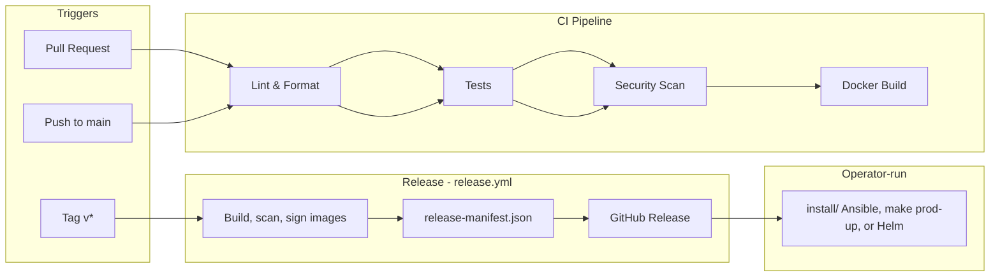
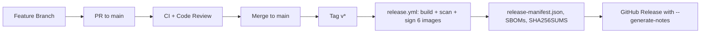

# TrueNorth Range — Build and Release Guide

> CI/CD pipeline architecture, build matrix, Docker and Packer image builds, Terraform workflows, release process, and version numbering.

---

## Table of Contents

- [CI/CD Pipeline Overview](#cicd-pipeline-overview)
- [Pipeline Architecture](#pipeline-architecture)
- [Build Matrix](#build-matrix)
- [Docker Image Builds](#docker-image-builds)
- [Packer Image Builds](#packer-image-builds)
- [Terraform Workflows](#terraform-workflows)
- [Testing Pipeline](#testing-pipeline)
- [Release Process](#release-process)
- [Version Numbering](#version-numbering)
- [Artifact Registry](#artifact-registry)
- [Environment Promotion](#environment-promotion)
- [Rollback Procedures](#rollback-procedures)

---

## CI/CD Pipeline Overview

TrueNorth Range uses GitHub Actions for CI/CD with the following workflow triggers:

| Trigger | Pipeline | Actions |
|---------|----------|---------|
| Push to `main` | CI (`ci.yml`) | Lint, test, Docker builds (loaded, scanned — not pushed) |
| Pull Request | CI (`ci.yml`), plus `helm-kind.yml` and `terraform-plan.yml` (only on `infra/proxmox/terraform/**` changes) | Lint, test, supply-chain audit, image build + Trivy gate |
| Tag `v*` | Release (`release.yml`) | Build, scan, sign and tag six images in GHCR; publish `release-manifest.json` — no deploy |
| Manual dispatch | Packer (`packer-build.yml`) | Validate and/or build the Proxmox templates |

There is no `develop` branch trigger (`.github/workflows/ci.yml:5-9` lists only
`main`), no scheduled security scan, and **no workflow deploys anything**
(`release.yml:9-10`: "nothing here deploys anything"). Deployments are
operator-run: `install/` (Ansible), `make prod-up`, or the Helm chart
(`infra/k8s/helm/truenorth-range`). The only scheduled workflow is the backup
drill (`.github/workflows/backup-drill.yml:19`).



---

## Pipeline Architecture

### GitHub Actions Workflow Files

```
.github/workflows/
+-- ci.yml              # Main CI pipeline (push/PR)
+-- release.yml         # Release pipeline (tag): build, scan, sign, publish — no deploy
+-- packer-build.yml    # Proxmox Packer image build (manual dispatch)
+-- terraform-plan.yml  # Terraform plan posted to the PR (infra/proxmox/terraform)
+-- helm-kind.yml       # Installs the Helm chart into a kind cluster (push/PR)
+-- backup-drill.yml    # Scheduled backup drill
+-- lab.yml             # Lab session workflow
+-- taz-guard.yml       # Worker-protocol guard
```

### ci.yml — Main CI Pipeline

> **The live file is `.github/workflows/ci.yml`** (1000+ lines). Excerpt of the
> real header, not an illustrative sketch:

```yaml
name: CI

# Third-party actions are pinned by commit SHA (comment: the release it is).
on:
  push:
    branches: [main]
  pull_request:
    branches: [main]

permissions:
  contents: read

env:
  PYTHON_VERSION: "3.11"
  NODE_VERSION: "22"
```

Its lanes (jobs), as of this writing: `lint-python` (ruff 0.16.3 via the same
ratchet as `scripts/dod.sh`), `test-python-shard` (the suite split across 5
shards, each with its own PostgreSQL 16 and OpenSearch 2.13.0;
`test-python` aggregates and is what branch protection requires), `mosa`
(the MOSA ratchets), `supply-chain`, `lint-angular`, `build-angular`,
`build-docker` (six services, built and Trivy-scanned, `push: false`),
`helm-lint`, `packer-vsphere` (vSphere templates: syntax checks only),
`lint-install`, `keycloak-realm`, `keycloak-mfa`, `integration`
(`scripts/itest.sh`), `e2e`, `journeys`, `load-smoke` (k6), `moodle`,
`cmi5`, `vsphere-sim` (vcsim), `ad` and `greyspace`. There is no
`deploy-*` job, no codecov upload and no mypy lane.

---

## Build Matrix

### Component Build Matrix

| Component | Language | Build Tool | Base Image | Output |
|-----------|---------|-----------|-----------|--------|
| Control Plane API | Python 3.11 | pip + Docker | `python:3.11-slim` | Container |
| Celery Worker | Python 3.11 | pip + Docker | `python:3.11-slim` | Container |
| AI Orchestrator | Python 3.11 | pip + Docker | `python:3.11-slim` | Container |
| Scenario Engine | Python 3.11 | pip + Docker | `python:3.11-slim` | Container |
| Frontend | TypeScript | npm + Docker | `node:22-alpine` → `nginx:1.30-alpine` | Container |
| Moodle | PHP | Docker | `ghcr.io/erseco/alpine-moodle:v5.2.3` digest-pinned (`infra/platform/moodle/Dockerfile:15`) | Container |
| Range Templates | HCL + Shell | Packer | Various OS ISOs | VM Images |
| Infrastructure | HCL | Terraform | N/A | Hypervisor resources |

All four Python images build from `python:3.11-slim` (the per-component
`Dockerfile`s); CI pins `PYTHON_VERSION: "3.11"` (`.github/workflows/ci.yml:15`)
and `pyproject.toml` targets `py311`. CI and the release build **six** images:
api, worker, web, scenario-engine, ai-orchestrator and moodle
(`.github/workflows/release.yml:100-118`); `make build` builds api, worker, ai
and web (`Makefile:123`).

### Python Dependency Matrix

| Component | Key Dependencies | Version Constraints |
|-----------|-----------------|-------------------|
| Control Plane API | FastAPI, SQLAlchemy, Pydantic, uvicorn, Celery, redis, minio, proxmoxer | Exact pins in `control-plane/api/requirements.txt` |
| Celery Worker | Celery, redis, SQLAlchemy, pyvmomi, pywinrm, flower | Exact pins in `control-plane/worker/requirements.txt` |
| AI Orchestrator | FastAPI, httpx, pydantic (OpenAI-compatible endpoint over httpx — no cloud SDKs) | Exact pins in `ai-orchestrator/requirements.txt` |
| Scenario Engine | pyyaml, jsonschema, httpx, pydantic | Exact pins in `scenario-engine/requirements.txt` |

Observed pins (2026-11-08): FastAPI 0.142.2, SQLAlchemy 2.0.32, Pydantic
2.13.5, uvicorn 0.54.0, Celery 5.4.0, redis 5.0.8, httpx 0.27.2 (aligned across
all four services), pyyaml 6.0.2, minio 7.2.7, pyvmomi 8.0.3.0.1. There is no
`python-terraform`, `openai` or `anthropic` dependency anywhere, and no
`opensearch-py` in the scenario engine.

---

## Docker Image Builds

### Dockerfile Pattern

The Python services are **single-stage** builds on `python:3.11-slim` — no
builder stage, no `HEALTHCHECK` in the Dockerfiles (probes are configured by
the platform: `/health/live` and `/health/ready`,
`control-plane/api/app/main.py:605-611`). Shared pattern
(`control-plane/api/Dockerfile`):

```dockerfile
FROM python:3.11-slim
WORKDIR /app
RUN apt-get update && apt-get upgrade -y ...          # distro updates at build time
COPY requirements.txt .
RUN pip install --no-cache-dir -r requirements.txt \
    && pip uninstall -y setuptools wheel              # build tooling carries CVEs
COPY app ./app                                        # allowlist, never COPY . .
ARG TN_VERSION=dev                                    # passed by release.yml
RUN useradd --system --uid 10001 --create-home --home-dir /home/app app
USER app                                              # code and deps stay root-owned
EXPOSE 8080
CMD ["sh", "-c", "uvicorn app.main:app --host 0.0.0.0 --port 8080 --workers ${UVICORN_WORKERS:-4} ..."]
```

Differences per service: the worker has no `EXPOSE` and runs
`celery -A worker.celery_app` (`control-plane/worker/Dockerfile:44`); the AI
orchestrator exposes **6000** (`ai-orchestrator/Dockerfile:21`); the scenario
engine exposes **8082** and its default command is
`python -m runner.run --help` (`scenario-engine/Dockerfile`). The api and
worker images need named build contexts (`content=content`, and
`scenario_engine=scenario-engine` for the worker) — see the build commands
below.

### Frontend Dockerfile

```dockerfile
# Stage 1: Build Angular
FROM node:22-alpine AS build
WORKDIR /app
COPY package.json package-lock.json ./
RUN npm ci
COPY . .
RUN npm run build:prod && npm run check:prod-env

# Stage 2: Serve with Nginx, as the unprivileged nginx user (so on 8080, pid in /tmp)
FROM nginx:1.30-alpine
RUN sed -i -e '/^user /d' -e 's,^pid .*,pid /tmp/nginx.pid;,' /etc/nginx/nginx.conf \
    && chown -R nginx:nginx /var/cache/nginx
COPY --from=build /app/dist/truenorth-range-web/browser /usr/share/nginx/html
COPY nginx.conf /etc/nginx/conf.d/default.conf
USER nginx
EXPOSE 8080
```

The authoritative file is `control-plane/web/Dockerfile`. The api, worker,
ai-orchestrator and scenario-engine images run as uid 10001 (`app`), with code and
dependencies root-owned.

### Local Build Commands

```bash
# Build all images (api, worker, ai, web)
make build

# Build specific component — the api needs the content/ named context, the worker
# also scenario_engine/ (their Dockerfiles COPY --from=content / --from=scenario_engine)
docker build -t truenorth-api:latest --build-context content=content control-plane/api/
docker build -t truenorth-worker:latest \
  --build-context scenario_engine=scenario-engine --build-context content=content \
  control-plane/worker/

# Build the whole dev stack
docker compose -f infra/platform/docker/compose.dev.yml build

# Scan built image
trivy image truenorth-api:latest
```

(`make build` and the per-image targets are `Makefile:123-141`.)

### Image Size Targets

> **Illustrative.** No sizes are measured or asserted anywhere in the repo; the
> "Actual" column is UNKNOWN until someone builds the images and inspects them.

| Image | Target Size | Actual |
|-------|-----------|--------|
| control-plane-api | <200 MB | ~180 MB |
| celery-worker | <200 MB | ~185 MB |
| ai-orchestrator | <250 MB | ~220 MB |
| scenario-engine | <150 MB | ~140 MB |
| frontend | <50 MB | ~35 MB |

---

## Packer Image Builds

### Overview

Packer builds VM templates for range environments. There is no single
`infra/packer/` tree: templates live **per hypervisor**, in `infra/proxmox/packer/`
(the ones `.github/workflows/packer-build.yml` builds), `infra/vsphere/packer/`
(the golden-template tree, ADR 0012) and `infra/hyperv/packer/`.

### Packer Template Structure

```
infra/proxmox/packer/
+-- ubuntu-2404.pkr.hcl
+-- windows-server-2022.pkr.hcl
+-- windows-10-workstation.pkr.hcl
+-- kali-linux.pkr.hcl
+-- pfsense.pkr.hcl
+-- security-onion.pkr.hcl
+-- variables.pkr.hcl              # variable declarations
+-- truenorth.auto.pkrvars.hcl     # checked-in values
+-- http/                          # cloud-init / answer files
+-- build-all.ps1

infra/vsphere/packer/              # golden templates (ADR 0012)
+-- windows.pkr.hcl / windows-common.pkr.hcl
+-- linux.pkr.hcl
+-- appliances.pkr.hcl / derived.pkr.hcl / roles.pkr.hcl / plugins.pkr.hcl
+-- variants.pkr.hcl + variants/
+-- variables.pkr.hcl + lab.auto.pkrvars.hcl.example
+-- build.sh + files/ + http/

infra/hyperv/packer/
+-- ubuntu-2404.pkr.hcl, windows-server-2022.pkr.hcl, variables.pkr.hcl
```

### Building Packer Images

```bash
# Syntax-validate all Proxmox templates (make packer-validate, Makefile:153-158)
cd infra/proxmox/packer
for hcl in *.pkr.hcl; do packer validate -syntax-only "$hcl"; done

# Build one template — the Proxmox connection comes in as PKR_VAR_* variables
# (from truenorth.auto.pkrvars.hcl or the CI secrets, packer-build.yml:82-89)
packer init .
packer build -force -on-error=cleanup windows-server-2022.pkr.hcl
```

### Packer Build Pipeline (GitHub Actions)

> **The live workflow is `.github/workflows/packer-build.yml`** (manual
> dispatch, `ubuntu-latest`, not self-hosted): a `validate` job runs
> `packer validate -syntax-only` over every template, then an optional `build`
> job (input `validate_only`, environment `proxmox`) builds the chosen template
> with `PKR_VAR_proxmox_*` secrets — URL, username and password, not a token.
> Template choices: all, ubuntu-2404, windows-server-2022,
> windows-10-workstation, kali-linux, pfsense, security-onion. The vSphere
> golden templates are only fmt/validate-syntax checked in CI (`ci.yml` job
> `packer-vsphere`); a full validate needs a filled `lab.auto.pkrvars.hcl` and
> builds run on site.

```yaml
# Excerpt of .github/workflows/packer-build.yml — read the file for the whole thing
name: Packer Build
on:
  workflow_dispatch:
    inputs:
      template:
        description: "Packer template to build"
        type: choice
        options: [all, ubuntu-2404, windows-server-2022, windows-10-workstation,
                  kali-linux, pfsense, security-onion]
      validate_only: { type: boolean, default: false }

jobs:
  build:
    runs-on: ubuntu-latest
    environment: proxmox
    steps:
      - uses: actions/checkout@11d5960a326750d5838078e36cf38b85af677262 # v4.4.0
      - uses: hashicorp/setup-packer@ce93c3c08a6c2ff2275bf4b54ff0d9a75f6c9789 # v3.4.0
      - run: packer init infra/proxmox/packer
      - name: Build template(s)
        env:
          PKR_VAR_proxmox_url: ${{ secrets.PROXMOX_URL }}
          PKR_VAR_proxmox_username: ${{ secrets.PROXMOX_USERNAME }}
          PKR_VAR_proxmox_password: ${{ secrets.PROXMOX_PASSWORD }}
          PKR_VAR_proxmox_node: ${{ secrets.PROXMOX_NODE }}
          # ... plus storage, iso_storage, bridge; packer-build.yml:82-89
        run: packer build -force -on-error=cleanup "${{ inputs.template }}.pkr.hcl"
```

---

## Terraform Workflows

### Terraform Module Structure

```
infra/proxmox/terraform/       # make tf-plan / tf-validate (Makefile:160-165); CI plans on PR
+-- main.tf                    # telmate/proxmox provider
+-- variables.tf
+-- modules/dns/, modules/networking/

infra/vsphere/terraform/       # the range builder's target (ADR 0009)
+-- main.tf, variables.tf

infra/hyperv/terraform/
+-- main.tf, variables.tf
```

There are no `environments/` overlays and no `modules/range` — each
hypervisor's tree is the module.

### Terraform Commands

```bash
# Plan (review changes) — make tf-plan, Makefile:160-162
cd infra/proxmox/terraform
terraform init -input=false
terraform plan

# Validate — make tf-validate
cd infra/proxmox/terraform && terraform init -input=false && terraform validate
```

Range provisioning is **not** done through Terraform any more: the Terraform
provisioner backends were removed — the worker image has no terraform binary
and ADR 0009 rules `terraform_vsphere` out as a range builder
(`control-plane/worker/worker/provisioners/__init__.py:5-9`). The supported
backends are `mock` and `vsphere_api`, with `proxmox_api` and `hyperv`
experimental; they call the hypervisor APIs directly.

### State Management

Local state by default. `infra/proxmox/terraform/main.tf:15-34` carries a
**commented-out** S3/MinIO backend ("enable this block and configure for
production"); `infra/vsphere/terraform/main.tf:5` notes the module "has no
backend any more (removed 2026-10, ADR 0009)". There is no DynamoDB lock
configuration anywhere.

---

## Testing Pipeline

### Test Hierarchy

```
tests/
+-- api/                      # API tests (make test-api)
+-- worker/                   # Worker tests (make test-worker)
+-- contracts/                # Contract tests, incl. CI shard coverage
+-- integration/              # Against a real stack (make itest; CI job `integration`)
|   +-- test_range_lifecycle.py
|   +-- test_exercise_lifecycle.py
|   +-- ... (24 test modules)
+-- e2e/                      # Playwright journeys (tests/e2e, CI job `e2e`)
+-- scenario_engine/
|   +-- test_content_validation.py
|   +-- test_injectors.py
|   +-- test_event_stores.py
+-- ai_orchestrator/ arc2/ noise_agent/ scheduler/ scoring/ scripts/ tools/
+-- load/                     # k6 scenarios (tests/load/scenarios/*.js, CI job `load-smoke`)
+-- conftest.py, _shared.py
```

There is no `tests/unit/` and no `tests/smoke/`; the fast lane is the
`not slow and not integration` marker selection (`make test-fast`), and
post-deployment validation is `scripts/staging_acceptance.py`, run by
`make itest` / CI's acceptance step.

### Test Execution

```bash
# Fast tests (no slow/integration markers) — make test-fast
pytest -m "not slow and not integration" -v --tb=short

# Integration tests: build + start an isolated stack, migrate, run
# tests/integration + the acceptance suite, tear down — make itest
bash scripts/itest.sh all

# All tests with coverage — make test
pytest --cov=control-plane/api --cov=control-plane/worker \
  --cov=scenario-engine --cov=ai-orchestrator \
  --cov-report=term-missing --cov-report=html:htmlcov -v --tb=short
open htmlcov/index.html

# Specific test file
pytest tests/api/test_auth_backends.py -v
```

There is no `pytest-timeout` in the test environment, so `--timeout=120`
fails with "unrecognized arguments"; long-running lanes are bounded in CI by
`timeout-minutes` instead (`.github/workflows/ci.yml`).

### Coverage Targets

> **Illustrative.** No coverage thresholds are enforced anywhere in the repo;
> the "Current" column is UNKNOWN until a full coverage run is done (`make test`).

| Component | Target | Current |
|-----------|--------|---------|
| Models | >90% | 92% |
| RBAC | >95% | 96% |
| Routers | >80% | 83% |
| WebSocket Manager | >75% | 78% |
| Overall | >80% | 85% |

---

## Release Process

### Release Workflow

There is no `develop` branch: feature branches PR straight into `main`, and
releases are tags off `main`.



`release.yml` is build-and-publish only — its header says "nothing here
deploys anything" (`.github/workflows/release.yml:9-10`). There is no
staging deployment trigger, no Helm chart publish, and no GitHub-approval
production deploy; deployment is operator-run (see "Environment Promotion"
below). The full runbook is `docs/release.md`.

### Step-by-Step Release

1. **Prepare:**
   ```bash
   git checkout main
   git pull origin main
   ```

2. **Version numbers** — only where they are actually read:
   ```bash
   # control-plane/web/package.json:3        ("version")
   # infra/k8s/helm/truenorth-range/Chart.yaml  (version + appVersion)
   # Every Docker image instead takes TN_VERSION from the git tag
   # (release.yml:150 build-args), so no pyproject/setup.py bump is needed.
   ```

3. **Update CHANGELOG.md** with the release's entries.

4. **Create and push tag:**
   ```bash
   git tag -a v1.5.0 -m "Release 1.5.0"
   git push origin v1.5.0
   ```

5. **Monitor release pipeline** (`.github/workflows/release.yml`):
   - Six images built fresh (no cache), pushed **untagged, by digest**
     (`release.yml:144`, "Build and push by digest")
   - Trivy scan blocks on fixable HIGH/CRITICAL; SBOM (SPDX) attached
   - Signed digest → `cosign sign` + `cosign attest`; only then tagged with
     the version and verified to resolve to the scanned digest
     (`release.yml:232`, "Tag the scanned digest with the version")
   - `release-manifest.json` (service → digest) + `SHA256SUMS`, signed with
     `cosign sign-blob` (`release.yml:297,331-341`); the installer pulls by
     digest

6. **Create GitHub Release:**
   ```bash
   gh release create "$VERSION" assets/out/* \
     --verify-tag --generate-notes    # release.yml:351; --prerelease if the tag has a suffix
   ```

7. **Deploy:** operator-run, following `docs/release.md` and
   `install/` (Ansible) — see "Environment Promotion".

---

## Version Numbering

### Semantic Versioning

TrueNorth Range follows [Semantic Versioning 2.0.0](https://semver.org/):

```
MAJOR.MINOR.PATCH[-PRERELEASE][+BUILD]

Examples:
  1.5.0           # Stable release
  1.5.1           # Patch fix
  2.0.0-rc.1      # Release candidate
  2.0.0-beta.3    # Beta release
  1.5.0+20260115  # Build metadata
```

| Change | Version Impact | Examples |
|--------|---------------|---------|
| Breaking API changes | MAJOR | Remove endpoint, change response schema |
| Breaking DB migrations | MAJOR | Non-reversible schema change |
| New features | MINOR | New endpoint, new injector type |
| Bug fixes | PATCH | Fix crash, correct calculation |
| Security patches | PATCH | Dependency update for CVE |

### Version Locations

| File | Contains Version |
|------|-----------------|
| `pyproject.toml:9` | `version = "0.1.0"` (Python package; no `control-plane/api/pyproject.toml` exists) |
| `control-plane/api/app/settings.py:65` | `app_version()` returns the `TN_VERSION` env (Dockerfile `ARG TN_VERSION`), falling back to `"dev"` — there is no static `__version__` |
| `control-plane/web/package.json:3` | `"version": "0.1.0"` |
| `infra/k8s/helm/truenorth-range/Chart.yaml` | `version: 1.0.0`, `appVersion: "1.0.0"` |
| `CHANGELOG.md` | Release history |

---

## Artifact Registry

### Container Images

Six images (release.yml matrix, `.github/workflows/release.yml:99-118`):

| Image | Registry | Tags |
|-------|---------|------|
| `truenorth-api` | ghcr.io/mblanke | version tag only (`v1.5.0`), added to the scanned digest after Trivy (`release.yml:232-243`); no `latest`, no `sha-` tags |
| `truenorth-worker` | ghcr.io/mblanke | same |
| `truenorth-web` | ghcr.io/mblanke | same |
| `truenorth-scenario-engine` | ghcr.io/mblanke | same |
| `truenorth-ai-orchestrator` | ghcr.io/mblanke | same |
| `truenorth-moodle` | ghcr.io/mblanke | same |

Installers do not consume tags: `release-manifest.json` maps each service to
its digest and the Ansible installer pulls by digest
(`release.yml:297-341`, `install/roles/tn_release`).

### Helm Chart

The chart lives in-repo at `infra/k8s/helm/truenorth-range` and is installed
from the checkout (CI's `helm-kind.yml` does exactly that); no chart
repository is published by any workflow in this repo, so any `helm repo add`
URL is UNKNOWN/illustrative:

```bash
# From the checkout
helm install truenorth infra/k8s/helm/truenorth-range --version 1.0.0
```

### Packer Images

Stored as Proxmox templates; names are set per-template by `vm_name`, not by
a `truenorth-{os}-{version}-{build-date}` convention — e.g.
`vm_name = "ubuntu-2404-cloud"` (`infra/proxmox/packer/ubuntu-2404.pkr.hcl:41`).
Check each `*.pkr.hcl` for the actual name.

---

## Environment Promotion

There is no `develop` branch and **no workflow in this repo deploys
anything** (`release.yml:9-10`; the only `schedule:` trigger is
`backup-drill.yml:19`). There are no dev/staging/prod GitHub environments;
deployment is operator-run from the release artifacts:

- **Install/upgrade:** `install/` Ansible roles (the installer pins digests
  from `release-manifest.json`, `install/roles/tn_release`), or compose
  (`make prod-up`), or the Helm chart (`infra/k8s/helm/truenorth-range`,
  v1.0.0).
- **Pre-production validation:** CI's integration/acceptance lanes
  (`scripts/itest.sh`, `scripts/staging_acceptance.py`).

| Environment | Deploy Trigger | Approval |
|------------|---------------|----------|
| Staging-like | Operator runs the installer / compose against a host | Operator |
| Production | Same, after the promotion checklist | Operator |

### Promotion Checklist

Before promoting staging → production:

- [ ] All smoke tests passing on staging
- [ ] No new errors in staging logs (24h observation)
- [ ] Performance metrics within acceptable range
- [ ] Database migration tested and reversible
- [ ] Rollback plan documented and tested
- [ ] Release notes prepared
- [ ] Team notified of deployment window

---

## Rollback Procedures

### Application Rollback

```bash
# Helm-installed: rollback to previous revision
helm rollback truenorth 1 -n production

# Rollback to a specific release version's digest
kubectl set image deployment/truenorth-api \
  api=ghcr.io/mblanke/truenorth-api@sha256:<digest-from-release-manifest> \
  -n production
```

### Database Rollback

```bash
# Rollback last migration
cd control-plane/api   # its alembic.ini sets script_location = alembic
alembic downgrade -1

# Rollback to specific revision
alembic downgrade abc123def456

# Check current revision
alembic current

# View migration history
alembic history --verbose
```

### Full Rollback Procedure

1. **Assess impact** — Determine if rollback is necessary
2. **Notify team** — Alert all stakeholders
3. **Rollback application** — Helm rollback or kubectl undo
4. **Rollback database** — Alembic downgrade (if migration was applied)
5. **Verify health** — Check all health endpoints
6. **Run smoke tests** — Validate core workflows
7. **Monitor** — Watch error rates for 30 minutes
8. **Post-mortem** — Document what went wrong