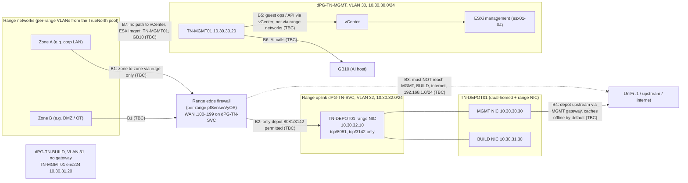

# ADR 0013: Range certification, credential hardening and template pinning

- **Status:** accepted 2026-10-21 (owner decision). **Amends ADR 0012** (see "What this changes in ADR 0012").
- **Date:** 2026-10-21
- **Code:** none yet. The work is sliced S1–S7, one GitHub issue and one PR each (titles "Range certification S<n>: ..."), plus an owner-decision issue for the network team. Each slice passes the gate, an adversarial review and CI before merge, one at a time.

## Context

`truenorth-ansible-range-kit` is a standalone Ansible "ranges as code" builder. It brings its own scenario compiler, VLAN/IP allocator, tags, `TrueNorth/Ranges` folder, Packer skeleton and agent guard hook. It has several good safety ideas: a live vDS preflight, promoted template builds, per-zone isolation validation, inventory-checked teardown, drift detection and a nightly canary.

TrueNorth already covers part of it: reset to baseline, guest-IP readiness and MAC reservation (#232), tags and folders (#234), and real integration modules (Greyspace, ARC², lab sessions) where TrueNorth is ahead of the kit.

An owner review on 2026-10-21 found gaps in TrueNorth's own provisioning that the kit's ideas close, and asked for six changes: stronger isolation evidence, credential hardening, atomic VLAN allocation, exact template versions, wider teardown ownership checks, and cleanup that maintenance windows cannot block. Two of these reverse parts of ADR 0012.

## Decision

### 0. Port the ideas; do not install the kit

The kit is **not installed** alongside TrueNorth. Its ideas are ported into TrueNorth's own provisioner. Three reasons:

1. **Duplication (ADR 0001).** It is a second vSphere provisioning path next to the worker's `vsphere_api` adapter. ADR 0001 puts every external system behind one adapter and registry; two builders for the same vCenter means two sets of rules to keep correct.
2. **Invisible ranges.** A range the kit builds has no TrueNorth record, so it has no Students, labs, live classroom, scoring or AAR, and TrueNorth's capacity and teardown logic cannot see it.
3. **Allocator collision.** The kit allocates VLANs and CIDRs from its own state on the same vDS that TrueNorth's allocator (`worker/range_alloc.py`, `network_reservations`) uses. Neither knows about the other's reservations.

Not ported: the guard hook and file-based approvals (TrueNorth has RBAC and an append-only audit log, ADR 0011, and agents need the owner's chat approval for real hardware), the scenario→range compiler, its Packer skeleton (ours is `infra/vsphere/packer/`), and its `integrations.json`.

### 1. Atomic VLAN/CIDR allocation, with a live recheck (S1)

- Allocation is one database transaction. The existing transaction-scoped advisory lock and the unique constraint on `network_reservations` (`worker/db_ops.py`, `pg_advisory_xact_lock`) also cover VLANs used outside TrueNorth.
- Before allocating, a live read of every vDS portgroup VLAN (trunk ranges expanded, `*-DVUplinks-*` skipped) records VLANs in use outside TrueNorth as `external` reservations.
- Immediately before creating each portgroup (`vsphere_api._prepare_sync`), the provisioner re-reads the live vDS. If the VLAN or the portgroup name has appeared since allocation, it **stops safely**: creates nothing, releases the reservation and fails with a clear reason.
- Installer settings `tn_vsphere_reserved_vlans` and `tn_range_reserved_cidrs` list site VLANs and CIDRs no range may use. Templates whose subnets overlap them are refused.

### 2. Templates are pinned to one promoted build (S2)

- A golden image gets a **promoted build**: build id, checksum, build date, ISO checksum and per-host copy names. Promotion is an audited admin action; registering a build records it, a human promotes it.
- At provision, a range resolves **one** promoted build per catalogue image and requires that exact build's copy on every host its placement uses. Placement chooses only hosts that hold it; a missing or mismatched copy on every host that fits fails the build.
- Promotion needs **at least one host copy** recorded for the build (a build recorded before replication cannot be promoted). Hosts without a copy are not used for that image.
- **No newest-copy selection and no plain-name fallback.** Both are removed from `vsphere_api` and from `template_tasks.prune_template_copies`. Every VM of one image in a range runs the same verified build, and the certification record (§6) says which.
- Transition: a flag (`TN_TEMPLATE_ALLOW_UNPROMOTED`) allows currently built, unpromoted images. It turns off **per image**: once an image has a promoted build, that image always uses it, whatever the flag says. (Amended 2026-10-21 after the S2 adversarial review; the first text turned the flag off globally at the first promotion.)

### 3. Credential hardening (S3)

- **The generic template password exists only during template construction.** It is invalidated before a range deployment completes: Sysprep (Windows) and cloud-init (Linux) replace it for every account, including the built-in Administrator, `soadmin` and the Linux build user.
- Readiness proves it: one guest-operations login with the template password per VM, which **must fail**.
- **No generic fallback.** The "Windows default = template password" behaviour (#185) and any site-wide range default are removed. Every declared account gets a unique generated password per range, sealed with the existing purpose-bound key (`tnsec:rc1:`, `range_credentials/service._issue`).
- **Reveal is audited.** Credentials are shown only through the role-filtered endpoint (ADR 0012 §13 roles stand). Each reveal writes an audit entry: who, which account, when. Students see only their machines.
- **No credentials or tokens in wiki pages.** Generated range pages list account names and link to the credentials panel.
- **Student rotation on reset and rebuild.** Student-visible accounts get new passwords on every reset or rebuild. Staff accounts stay stable unless an admin rotates them. This **supersedes the 2026-10-19 "later" deferral** (review finding M1, issue #198).
- Migration: existing ranges keep working; their wiki pages are regenerated without secrets.

### 4. Isolation evidence per zone (S4)

- A probe runs in **every security zone** (one per range network), using a Linux VM with VMware Tools or a TrueNorth-injected probe on a Windows VM, through the existing guest operations (`vsphere_api.run_in_guest`).
- Checks per zone: a self-test against its own gateway; IPv4 TCP and ICMP to site targets (management gateway, DNS, vCenter, the depot's management address); IPv6 (route present, global address assigned, reachability of site v6 targets); DNS (an internal name resolves, an external name must not); upstream routing (a traceroute or TTL probe must not cross the range edge); permitted exceptions (the depot at 10.30.32.10 tcp/8081 and 3142 **must** succeed, every other depot port must fail).
- Each check has exactly one result class:

  | Result | Meaning |
  |---|---|
  | `proven_unreachable` | the probe timed out **and** the zone's self-test passed |
  | `reachable` | the target answered |
  | `inconclusive` | the self-test failed, the guest operation failed, or the zone has no probe |
  | `connect_failed_only` | a refused or failed connect; **not** counted as proof of isolation |

- The verdict is **Isolated** only if every zone has a probe and every non-exception check is `proven_unreachable`. Any weaker verdict states exactly what is missing.
- Site targets and permitted exceptions come from installer settings. The mode `RANGE_ISOLATION_CHECK=warn|enforce` stays at **`warn`**. **`enforce` waits for the network team's decision** on the isolation model and trust boundaries (below).

### 5. Teardown by independently identified inventory, and drift (S5)

- Before destroy, TrueNorth builds the range's **independently identified inventory** from what it recorded at clone time: VM managed-object IDs and instance UUIDs, their datastores and disk files, folder MoIDs, snapshot IDs, portgroup keys, and MAC and VLAN reservations.
- Destroy deletes only items whose recorded IDs match. Anything else carrying the range's annotation or tag is **reported as unidentified, not deleted**. Annotations and tags are hints, never authority to delete.
- An admin override confirms items only by their listed MoID, typed back. It never deletes by annotation.
- Afterwards TrueNorth verifies that none of the recorded IDs remain (VMs, disks, portgroups, folder) and records the result.
- A periodic drift check next to `health_check_ranges` compares live VM IDs, CPU/RAM, NICs, portgroups, MACs, portgroup VLANs and snapshots with the record, and raises range warnings.
- As built (S5, #243; `worker/range_inventory.py`, `app/range_inventory/`):
  - a VM whose instance UUID was recorded is the range's exactly when that UUID is still under its MoID, whatever it is named or annotated now; ranges built before S5 keep the annotation/name rule and their teardown is graded `incomplete` (legacy). An instance UUID can only be changed by someone with vCenter rights to reconfigure the VM (who could delete it anyway), so the moid plus UUID pairing protects against TrueNorth's own mistakes and reused ids, not against a vCenter administrator;
  - "carrying the range's mark" means its annotation, its `tn-range` tag, or (port groups) S1's owner mark; the tag is kept while an unidentified VM carries it;
  - teardown is `pass` only with zero recorded IDs left and nothing unidentified, `fail` when a recorded ID remains (a disk file included), else `incomplete`;
  - drift that can break isolation or identity (VM replaced, NIC port group or MAC, NIC added or removed, port group gone or re-VLANed) is `fail`; a VM gone, CPU/RAM or snapshot changes are `incomplete`. The record gets a `drift` entry only when the result changes;
  - the override is `range:admin`, needs a reason, and each item's MoID must be typed back exactly and be in the listed set; the worker re-checks MoID plus instance UUID and the range's mark (annotation or tag, read again), or port-group key and owner mark, before deleting. Only VMs and port groups can be confirmed; disk files and folders cannot. Afterwards the range's own recorded VM folder is removed if, and only if, it is now empty. It is cleanup after a teardown, so a maintenance window does not refuse it (§7's teardown rules are unchanged).

### 6. The Range Certification Record (S6)

Each range deployment gets **one immutable, append-only record** (a table plus a signed JSON export) that answers "is this range safe, ready and certified for Students?". Records are never edited; corrections append.

Contents:
- deployment id, range, range template and plan hash;
- template provenance: the promoted build id and checksum each VM got (§2);
- network allocation: VLANs, CIDRs and MACs, with the external-collision checks (§1);
- guest readiness (#232);
- credential state: template password invalidated, rotation done (§3);
- isolation evidence per zone (§4);
- drift results over the range's life, and teardown evidence (§5);
- timestamps, and the identity behind every approval, override, force and emergency teardown.

Verdicts:

| Verdict | When |
|---|---|
| `Certified for Students` | every section present and passing, isolation verdict Isolated |
| `Ready, not certified (reasons)` | the range works but evidence is missing or weaker than required; the reasons are listed |
| `Not safe` | a check failed outright: e.g. a zone `reachable` outside its exceptions, the template password still works, or a pinned build mismatched |

It is shown to staff on the range page and in Ops Center, exportable as JSON or PDF (the AAR PDF machinery). Instructors can require a certified range when booking. The record is honest evidence for troubleshooting, incident reconstruction and later assurance reporting; it is not itself proof that a check ran.

### 7. Maintenance windows never block cleanup (S7)

- Admins define windows in the scheduler. Provision, reset and **normal** destroy are refused inside them.
- **Always allowed**, inside or outside a window: automated failure cleanup (failed builds, canary teardown, lease expiry) and authorised emergency teardown (`range:admin` plus a reason, audited, written to the certification record).
- A nightly canary (beat-scheduled, **off by default**) builds a small range, certifies it, resets it and tears it down, outside windows and when capacity allows. On failure it tears down through the bypass and alerts.

## What this changes in ADR 0012

ADR 0012 numbers its decisions §1–§14; the planning notes called them D1–D15. Both are given.

| ADR 0012 | Was | Now (this ADR) |
|---|---|---|
| §5 (D5) generic build password | generic, documented in the wiki; admins may change it | exists **only during template construction**; invalidated before deployment and proven invalid by readiness (§3) |
| §12 (D6) declared accounts | "falls back to the generic default" | **no generic fallback**; unique per-range generated passwords, sealed (§3) |
| §13 (D7) who sees credentials | role table | role table stands; **every reveal is audited** (§3) |
| §14 (D8) generated wiki pages | staff-only page with the full credential list | **no credentials or tokens in any wiki page**; names plus a link to the credentials panel (§3) |
| §6 (D13) per-host copies | clone the **newest** `<id>@<host>-*` copy, falling back to the plain name | clone one **promoted build id + checksum** on every host; **no newest-copy selection, no plain-name fallback** (§2) |
| Deferred 2026-10-19: rotation "later" | deferred | **Student rotation on reset/rebuild is required** (§3); supersedes #198 |

The rest of ADR 0012 (prebuilt, key-free, offline-built templates; per-host copies themselves; build network; approvals) stands.

## Trust boundaries

Every boundary below is **to be confirmed by the network team**. This diagram is the questionnaire's starting point, not a statement of tested behaviour. Addresses come from `docs/deployment/vmware-site-runbook.md`; vCenter, ESXi management and GB10 addresses are not recorded in the repo and are left blank.

| # | Boundary | Intended rule | Status |
|---|---|---|---|
| B1 | between zones inside a range | only through the range's edge firewall or routed appliances, per the range template | to be confirmed by network team |
| B2 | range edge → depot range NIC 10.30.32.10 | tcp/8081 (Nexus) and tcp/3142 (apt-cacher-ng) only | to be confirmed by network team |
| B3 | range edge → UniFi/upstream | dropped: no internet, MGMT, BUILD or 192.168.1.0/24 | to be confirmed by network team |
| B4 | depot MGMT/BUILD NICs | the depot is dual-homed (plus the range NIC); its upstream goes through the MGMT gateway, caches offline by default; no forwarding between its NICs | to be confirmed by network team |
| B5 | TN-MGMT01 ↔ vCenter/ESXi | management only; range traffic never reaches them | to be confirmed by network team |
| B6 | TN-MGMT01 ↔ GB10 | AI traffic on the management side only | to be confirmed by network team |
| B7 | range networks → vCenter, ESXi mgmt, TN-MGMT01, GB10 | no path | to be confirmed by network team |

**Open questions for the network team** (tracked as an owner-decision issue): the isolation model, `uplink_none` (no uplink, VMs held together by DRS affinity) versus `vlan_trunk_no_l3` (trunked VLANs with no layer-3 interface); the VLAN pool and reserved VLANs and CIDRs; the isolation probe targets, including IPv6; the depot and any other permitted exceptions; and who signs off. Until they answer, isolation runs in `warn` mode: a weak isolation result is reported in the record and lowers the verdict, but does not block the build.

## Consequences

- **Safer, slower first deploys.** A missing promoted copy or a VLAN collision now fails a build that would previously have "worked" with the wrong template or a shared VLAN.
- **Templates need a promotion step.** Building a template is no longer enough; the platform administrator must promote it before ranges use it (transition flag, per image, for images not yet promoted).
- **Credentials can no longer be read in the wiki.** Staff use the credentials panel, and every reveal leaves an audit entry. Students must re-read their passwords after a reset.
- **Isolation becomes evidence, not assumption**, but `enforce` is blocked on an external decision. Until then the certification verdict reports isolation honestly as weaker than required where it is.
- **Teardown may leave things behind on purpose.** Unidentified items are reported, not deleted; an admin confirms them by MoID. This trades tidiness for never deleting something TrueNorth did not create.
- **New storage:** promoted-build, inventory, isolation-evidence, drift and certification tables. Per ADR 0003 they go in per-section modules, not `models.py`, `schemas.py` or `worker/tasks.py`, and new API endpoints regenerate the OpenAPI contract (ADR 0002).
- **Sequencing:** S2 and S5 both change `vsphere_api.py` substantially and should land one after the other (S1's recheck in `_prepare_sync` also touches it, in a small region). S6 can start with the record skeleton but its full content depends on S1–S5.
