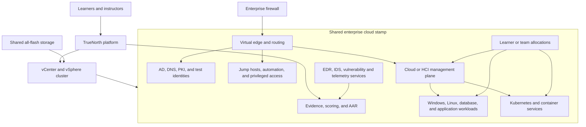

# TrueNorth Enterprise Cloud Range Requirements

**Status:** Proposed requirements baseline  
**Owner:** TrueNorth product and infrastructure teams  
**Last verified against source:** 2026-10-23  
**Target release:** To be planned  

## 1. Purpose

This document defines the requirements for using TrueNorth (TN) to deliver a
virtual enterprise cloud inside an isolated on-premises network. The environment
must let learners administer, attack, defend, troubleshoot, and recover a cloud
estate while TN manages course access, exercise state, scenario injects, evidence,
scoring, and after-action review.

The recommended first implementation is a **shared Azure-style cloud stamp**. TN
creates or reserves one enterprise environment for a class and assigns each learner
an isolated identity, project or subscription boundary, namespace, workload set, and
evidence scope inside it. A complete cloud is not cloned for every learner.

This document is a design and procurement baseline. It is not evidence that nested
Azure Local, Azure Stack Hub, or the hardware configuration has been deployed or
validated with TN.

> **Scale boundary:** The three-host configuration in this document is an initial
> cloud-stamp pilot and module baseline. It is not the infrastructure design for the
> complete TN training estate or the programme target of 70,000 concurrent allocated
> vCPU. That target requires multiple compute, management, telemetry, and storage pods
> and a separate measured capacity design.

## 2. Decision summary

### 2.1 Recommended target

Build an Azure-style training environment on the TN-supported vSphere range plane.
Use real Windows and Linux identity, networking, compute, storage, Kubernetes,
application, security, and telemetry services. Reproduce the operating model and
security boundaries that learners must understand without requiring every Azure
service or API to be present.

The initial cloud-module pilot hardware target is:

- three R6625-class virtualization hosts;
- 64–96 physical CPU cores per host;
- 768 GB–1 TB ECC RAM per host;
- 8–15 TB local enterprise NVMe per host;
- resilient shared all-flash storage for templates, VM data, snapshots, and telemetry;
- dual 25 GbE links per host, with 100 GbE uplinks where the storage design requires it;
- redundant switching and out-of-band management; and
- an enterprise firewall between management, range, external-services, and egress zones.

Three hosts are the minimum pilot recommendation because the cluster must run a
scheduled exercise after losing its largest host. A two-host cluster can support a
demonstration but does not provide comfortable maintenance or failure capacity.

### 2.2 Product choices that must remain distinct

| Target | What it provides | Intended TN use | Procurement consequence |
|---|---|---|---|
| Azure-style simulation | Enterprise cloud architecture, identities, workloads, segmentation, telemetry, and operating procedures | Recommended for general cyber training | Standard TN virtualization cluster |
| Virtual Azure Local | Nested Microsoft HCI control and workload plane for evaluation or training | Optional fidelity module | Nested virtualization and Microsoft licensing; unsupported for production by Microsoft |
| Physical Azure Local | Supported Microsoft HCI on validated physical hardware | Dedicated Azure Local administration training | Separate validated hardware design |
| Azure Stack Hub | On-premises Azure Resource Manager and supported Azure services | Only when exact Azure Stack operation is a learning objective | Authorized integrated system with 4–16 servers |

Azure Local is not a complete replacement for Azure Stack Hub. Azure Stack Hub is not
software that TN can turn into a supported installation on arbitrary nested VMs.

## 3. Scope

### 3.1 In scope

- One shared enterprise cloud stamp for a scheduled class or exercise.
- Azure-style identity, role assignment, tenant and project boundaries.
- Windows, Linux, database, Kubernetes, container, and application workloads.
- Enterprise management, privileged access, automation, and CI/CD services.
- Segmented management, production, development, DMZ, security, and adversary networks.
- Security controls and telemetry suitable for blue-team and red-team exercises.
- Learner allocation, instructor control, evidence collection, scoring, reset, and AAR.
- Optional nested Azure Local for specific learning objectives.
- Disconnected operation where the selected software and licences permit it.
- Capacity planning for one and two concurrent class environments.

### 3.2 Outside the initial scope

- A supported production Azure service for business workloads.
- Full behavioral reproduction of every Azure API or managed service.
- One complete cloud deployment per learner.
- Production federation with an organization's live identity tenant.
- Direct access from a training workload to enterprise production networks.
- Azure Stack Hub procurement or installation without an authorized vendor design.
- GPU capacity for cloud workloads; TN AI capacity is sized separately.

## 4. Users and required outcomes

### 4.1 Learner

The learner shall be able to:

1. enter the assigned exercise from TN;
2. see only the cloud resources assigned to the learner or team;
3. use the required portal, shell, remote desktop, console, and workload interfaces;
4. administer, troubleshoot, attack, defend, or recover the assigned resources;
5. leave and resume an active exercise without losing authorized state;
6. submit artifacts and generate automatically collected evidence; and
7. receive results tied to the applicable course and exercise objectives.

### 4.2 Instructor and exercise controller

The instructor shall be able to:

1. schedule a cloud exercise against available capacity;
2. create or select learner and team allocations;
3. confirm environment health before admitting learners;
4. start, pause, resume, and stop the exercise;
5. run controlled scenario injects and observe their status;
6. observe learner progress and evidence without crossing tenant boundaries;
7. reset a learner workspace or the full class stamp at a defined recovery point; and
8. produce an AAR that preserves learner, team, objective, event, and evidence relationships.

### 4.3 Platform administrator

The administrator shall be able to:

1. register and test the hypervisor, networks, datastores, templates, and supporting services;
2. declare usable capacity and failure reserve;
3. monitor physical, virtual, storage, and network saturation;
4. prevent a launch that would violate capacity or isolation requirements;
5. identify every outer VM and allocation belonging to an exercise;
6. clean up abandoned resources without touching unrelated workloads; and
7. audit privileged actions and changes to the cloud range definition.

## 5. Logical architecture

The physical management plane, TN platform services, vCenter, storage management,
and out-of-band management shall remain outside learner-controlled range networks.

## 6. Workload model

### 6.1 Initial shared cloud stamp

The first implementation should be sized for the following approximate allocation.
These are design values to validate through a measured pilot, not guarantees.

| Workload group | Allocated vCPU | RAM | Provisioned disk |
|---|---:|---:|---:|
| Identity, DNS, PKI | 8–16 | 32–64 GB | 300–600 GB |
| Cloud or HCI management | 32–64 | 128–256 GB | 2–4 TB |
| Management and jump systems | 8–16 | 32–64 GB | 300–600 GB |
| Application and database workloads | 32–64 | 128–256 GB | 2–4 TB |
| Kubernetes and container services | 24–48 | 96–192 GB | 1–3 TB |
| Security and telemetry services | 24–48 | 96–256 GB | 2–10 TB |
| Adversary and exercise support systems | 16–32 | 64–128 GB | 500 GB–1 TB |
| **Planning range** | **144–288** | **576 GB–1.2 TB** | **8–23 TB** |

The workload may contain 25–40 outer VMs. If Azure Local is nested, its guest VMs
consume the RAM and CPU assigned to the outer Azure Local node VMs; they are not free
capacity merely because vCenter cannot see them individually.

### 6.2 Concurrency assumptions

- Baseline: one rich shared cloud stamp, 15–30 active learners.
- Growth: two concurrent class stamps or one class plus a red-team rehearsal.
- Learners share foundation services and receive separate accounts, projects,
  namespaces, networks, workloads, and evidence boundaries.
- Dedicated high-load resources may be assigned per team where objectives require them.
- Capacity is based on simultaneously powered workloads, not catalogue size.

## 7. Functional requirements

### 7.1 Environment definition and lifecycle

- **CR-FR-001:** TN shall represent the cloud stamp as a versioned, reviewable exercise dependency.
- **CR-FR-002:** A release shall identify the required templates, networks, resource limits, health checks, access methods, and evidence checks.
- **CR-FR-003:** Repeating deployment of the same approved release shall be idempotent.
- **CR-FR-004:** TN shall distinguish foundation services from learner or team allocations.
- **CR-FR-005:** TN shall preserve the foundation when resetting one learner allocation.
- **CR-FR-006:** TN shall support full-stamp snapshot, rebuild, or documented recovery procedures.
- **CR-FR-007:** A failed deployment shall produce a clear terminal or recoverable state and identify residual resources.
- **CR-FR-008:** Cleanup shall be scoped by TN-owned identifiers and shall not delete unrelated hypervisor objects.

### 7.2 Allocation and access

- **CR-FR-020:** Every learner or team shall receive a unique cloud identity and allocation.
- **CR-FR-021:** An allocation shall define roles, permitted resources, network access, and evidence scope.
- **CR-FR-022:** Learner access shall be issued only after required health checks pass.
- **CR-FR-023:** TN shall expose the required console or launch links from the learner activity.
- **CR-FR-024:** A learner shall be able to resume an unexpired session.
- **CR-FR-025:** Instructors shall be able to revoke an allocation without stopping the whole class.
- **CR-FR-026:** Test identities shall not be trusted by or synchronized into production identity systems.

### 7.3 Scenario, evidence, and assessment

- **CR-FR-040:** Scenario injects shall target the cloud stamp, a team allocation, or a specific workload.
- **CR-FR-041:** Every automated assessment shall identify its authoritative evidence source.
- **CR-FR-042:** Validators shall fail closed when required telemetry is absent or stale.
- **CR-FR-043:** TN shall record exercise, release, learner or team, objective, event time, and validator version with scored evidence.
- **CR-FR-044:** Instructor overrides and manual acknowledgements shall be audited.
- **CR-FR-045:** AAR data shall distinguish shared infrastructure events from learner-specific actions.

### 7.4 Operations

- **CR-FR-060:** Administrators shall be able to test hypervisor and supporting-service connectivity.
- **CR-FR-061:** TN shall prevent admission when compute, memory, storage, network, or allocation capacity is insufficient.
- **CR-FR-062:** Scheduling shall account for overlapping exercises and reserved failure capacity.
- **CR-FR-063:** Operators shall be able to reconcile TN state with actual hypervisor objects.
- **CR-FR-064:** Monitoring shall show current demand, reservations, saturation, deployment failures, and cleanup failures.
- **CR-FR-065:** Templates and nested-host images shall have an owner, version, patch state, and rollback path.

## 8. Non-functional requirements

### 8.1 Availability and recovery

- **CR-NFR-001:** Production sizing shall use N+1 compute capacity: all critical exercise workloads must fit after losing the largest host.
- **CR-NFR-002:** Planned host maintenance shall not require cancelling an active exercise when N+1 capacity is healthy.
- **CR-NFR-003:** Management, storage, and range networks shall not depend on a single switch port or host NIC.
- **CR-NFR-004:** The platform shall document recovery point and recovery time targets for the foundation, allocations, and evidence separately.
- **CR-NFR-005:** Recovery tests shall include failed provisioning, interrupted reset, host loss, storage interruption, and exhausted capacity.

### 8.2 Performance

- **CR-NFR-020:** Initial CPU planning shall use no more than four allocated vCPU per physical core for general range VMs.
- **CR-NFR-021:** Nested virtualization, database, and sustained compute workloads shall initially use no more than two allocated vCPU per physical core.
- **CR-NFR-022:** Planned memory capacity shall not depend on hypervisor memory overcommit.
- **CR-NFR-023:** At least 30% of usable exercise storage shall remain free for snapshots, clones, resets, and temporary growth.
- **CR-NFR-024:** A pilot shall measure simultaneous boot, login, telemetry, snapshot, and reset behavior at intended class size.
- **CR-NFR-025:** Production admission limits shall be set from measured pilot results rather than vendor maximums.

### 8.3 Security and isolation

- **CR-NFR-040:** Management, storage, vMotion, platform, range transit, tenant workload, adversary, and controlled egress traffic shall use explicit security zones.
- **CR-NFR-041:** Learner-controlled networks shall have no direct route to hypervisor, storage, BMC, TN administrative, or enterprise production interfaces.
- **CR-NFR-042:** East-west access between learner or team allocations shall be denied unless an exercise explicitly requires it.
- **CR-NFR-043:** Internet access shall be denied by default and enabled through logged policy for approved destinations or simulations.
- **CR-NFR-044:** Nested network functions requiring promiscuous mode, MAC changes, or forged transmit acceptance shall be limited to dedicated port groups.
- **CR-NFR-045:** Administrative access shall use named identities, MFA where supported, least privilege, and centralized audit logging.
- **CR-NFR-046:** Exercise data, evidence, and credentials shall follow the TN tenant boundary and retention policy.
- **CR-NFR-047:** Malware-capable exercises shall use separate containment controls and an approved operating procedure.

### 8.4 Portability and supportability

- **CR-NFR-060:** Cloud range definitions shall separate learning intent from hypervisor-specific template and network identifiers.
- **CR-NFR-061:** External cloud or HCI products shall be integrated behind the applicable TN adapter boundary.
- **CR-NFR-062:** Unsupported nested configurations shall be labelled in the catalogue and shall not be presented as production reference architectures.
- **CR-NFR-063:** Microsoft, VMware, operating-system, and security-product licensing shall be confirmed before a course release is approved.

## 9. Hardware requirements

### 9.1 Recommended cloud-module pilot baseline

| Component | Minimum recommended configuration | Quantity |
|---|---|---:|
| Virtualization host | 64–96 physical cores, 768 GB–1 TB ECC RAM, enterprise boot mirror, 8–15 TB enterprise NVMe, dual-port 25 GbE, redundant power, BMC | 3 |
| Shared storage | Resilient all-flash datastore sized for active VMs, templates, snapshots, reset workspace, and telemetry | 1 resilient service |
| Top-of-rack switching | Redundant 25 GbE access with sufficient 100 GbE uplinks or inter-switch capacity | 2 |
| Security gateway | Enterprise firewall supporting required segmentation, controlled egress, logging, and VPN/administrative access | 1 HA service or pair |
| Management | vCenter, DNS, NTP, certificate, monitoring, backup, and out-of-band management services | As designed |
| Backup/archive | Separate failure domain for configuration, critical evidence, and recoverable templates | 1 service |

The working kit inventory identifies an R6625 hypervisor variant with a 96-core AMD
EPYC-class CPU, 1 TB RAM, and approximately 15 TB NVMe. Three hosts at that
configuration provide 288 physical cores, 3 TB RAM, and approximately 45 TB local
NVMe before reserves. Exact SKUs, usable storage, endurance, NICs, support, power, and
cooling remain subject to the final quote.

### 9.2 Cloud-module pilot server shortlist

The preferred server class is a current-generation **2U, single-socket AMD EPYC
9005 platform**. One socket provides 12 memory channels, high core density, and enough
PCIe lanes for NVMe and high-speed networking. For the TN workload this normally
provides better value and a simpler NUMA topology than buying a dual-socket server.

Request comparable bids for the following platforms:

| Rank | Platform | Fit for TN | Material distinction |
|---:|---|---|---|
| 1A | Dell PowerEdge R7715 | Preferred Dell value platform | 2U, one EPYC 9005 CPU, 24 DIMMs, up to 40 E3.S NVMe drives; fits the existing Dell-oriented kit plan |
| 1B | HPE ProLiant Compute DL345 Gen12 | Preferred HPE value platform | 2U, one EPYC 9005 CPU, 24 DIMMs, up to 36 EDSFF NVMe drives, six PCIe 5.0 slots, and broad GPU expansion |
| 2A | Dell PowerEdge R6715 | Rack-density alternative | 1U equivalent with up to 20 front plus two rear E3.S drives; less expansion and greater cooling density |
| 2B | HPE ProLiant Compute DL325 Gen12 | Rack-density alternative | 1U equivalent with up to 20 E3.S drives; suitable when shared storage removes the need for 2U expansion |
| 3A | Dell PowerEdge R7725 | Scale-up exception | Two EPYC 9005 sockets and very high core density; larger failure domain and software-licensing exposure |
| 3B | HPE ProLiant DL385 Gen11 | Scale-up exception | Two EPYC 9005 sockets; use only when measured demand exceeds the single-socket platforms |

The R7715 and DL345 Gen12 are operationally equivalent for the initial TN cluster.
The vendor decision should be made from normalized five-year bids, support quality,
delivery, hypervisor compatibility, and the value of maintaining one hardware and
management ecosystem. The HPE chassis has a higher published maximum CPU core count
and more GPU expansion. The Dell chassis aligns with the existing Dell server and
switch plan and offers slightly more maximum EDSFF drive positions. Neither difference
matters to the baseline configuration.

#### Bid configuration per host

Every vendor shall quote the same functional configuration:

| Component | Required bid configuration | Reason |
|---|---|---|
| Chassis | R7715 or DL345 Gen12, 2U single socket, air cooled | Expansion without liquid-cooling dependency |
| CPU | 1 × AMD EPYC 9655P, 96 cores | Strong balance of VM density, clock speed, and CPU cost per core |
| Memory | 12 × 96 GB DDR5 RDIMM, 1,152 GB total, one DIMM per channel | Uses all 12 memory channels and leaves a supported expansion path |
| Boot | Vendor hot-plug mirrored NVMe boot device | Keeps hypervisor boot separate from workload drives |
| Local flash | 4 × 3.84 TB enterprise mixed-use NVMe minimum | Fast scratch, cache, local recovery, and temporary range capacity |
| Network A | 1 × dual-port 25 GbE OCP 3.0 adapter | Range, management, and migration traffic |
| Network B | 1 × dual-port 25 GbE PCIe adapter | Adapter and switch redundancy; storage or additional range traffic |
| Optional network | Dual-port 100 GbE PCIe adapter priced separately | Add only if the NetApp design or measured ingest requires it |
| Security | TPM 2.0, Secure Boot, signed firmware, locking bezel | Platform integrity and physical control |
| Management | Full remote-console and virtual-media licence | Unattended operation and recovery |
| Power | Redundant high-efficiency PSUs sized for the quoted configuration | Host resilience and measurable power planning |
| Support | Five years, 24×7, four-hour onsite or closest available equivalent | Matches production range service expectations |
| Included items | Rails, cable arm where used, power cords, optics/DACs, drive carriers, and all risers/enablers | Prevents unusable or misleadingly low bids |

Twelve 64 GB DIMMs, for 768 GB per host, are an acceptable cost-reduction option for
a measured one-class deployment. Twelve 128 GB DIMMs, for 1.5 TB per host, are the
preferred growth option. Do not save money by populating fewer than 12 channels; that
reduces memory bandwidth on a VM-dense host.

AMD publishes the EPYC 9655P as a 96-core, one-socket part with a 2.6 GHz base clock,
up to 4.5 GHz boost, 384 MB L3 cache, 12 memory channels, and 128 PCIe 5.0 lanes. Its
published 1,000-unit CPU price is USD 7,958, compared with USD 6,130 for the 64-core
EPYC 9555P. Those figures make the 9655P approximately 13% less expensive per core at
the processor level while providing 50% more cores. Actual server and software prices
must come from the vendor bids.

#### Procurement rule

Select the lowest evaluated five-year price that meets all mandatory requirements.
The evaluation shall include:

- chassis, CPU, memory, drives, NICs, optics, management licences, and support;
- hypervisor, Windows, database, and other per-core software costs;
- rack space, expected power, cooling, and UPS capacity;
- delivery time and availability of matching replacement parts;
- firmware and hypervisor compatibility for the full proposed configuration;
- the cost of enough hosts to preserve N+1 capacity; and
- benchmark results from the TN pilot rather than vendor maximum specifications.

If the normalized Dell and HPE bids are within 10%, prefer Dell to preserve the
current kit's Dell management, parts, switching, and support alignment. If HPE is more
than 10% less after normalization and satisfies the same support and compatibility
requirements, the DL345 Gen12 is an equally suitable TN host.

The previously considered R6625 remains viable when an existing discounted quote is
materially below the new platforms. Compare it as a complete configuration. A current
single-socket 96-core host is preferable when prices are close because it removes the
need for a second processor and starts a new purchase on the current platform generation.

### 9.3 Growth baseline

For two concurrent rich environments, use four hosts with 64–96 cores and approximately
1 TB RAM each, plus 30–60 TB of usable all-flash storage. Six or more hosts should be
considered when concurrent cloud stamps must survive maintenance and host failure
without reducing class size.

### 9.4 Sizing method

For each exercise release:

1. Sum powered-on outer-VM vCPU, RAM, and expected used disk.
2. Add TN platform and infrastructure consumption if they share the cluster.
3. Convert vCPU to physical cores using the workload-appropriate ratio.
4. Add snapshot, clone, telemetry, and reset working space.
5. Reserve at least 15% operational headroom and 30% free usable storage.
6. Remove the largest host and confirm that critical workloads still fit.
7. Test boot and reset storms at the intended number of learners.
8. Set TN admission limits below the measured saturation point.

Storage capacity alone is insufficient. The pilot must record read/write latency,
IOPS, throughput, snapshot duration, clone duration, and telemetry ingest behavior.

## 10. Network requirements

The design shall provide separate logical zones for:

- BMC and out-of-band management;
- hypervisor and vCenter management;
- storage traffic;
- migration traffic;
- TN platform services;
- shared cloud management;
- learner and team workloads;
- application production and development;
- DMZ and simulated external services;
- security monitoring and telemetry;
- adversary infrastructure; and
- controlled internet or enterprise-service egress.

Routing between range zones shall occur through policy enforcement points where the
exercise requires visible controls. Hypervisor trunk and port-group capacity must
cover the maximum number of concurrent stamp and allocation networks. Nested cloud
networking shall be validated on the exact vSphere version, virtual switch type, NIC,
and security policy before content depends on it.

## 11. Microsoft platform requirements

### 11.1 Virtual Azure Local option

Microsoft describes virtual Azure Local as an evaluation configuration and states
that virtual deployment is not supported in production. Microsoft's minimum physical
host is 48 GB RAM for one virtual node or 72 GB for two. Each virtual node requires at
least four virtual cores, 32 GB RAM, a 127 GB boot disk, two data disks, and the
required nested networking configuration. These minimums prove installation; they do
not represent a useful TN class environment.

The TN starting profile should use four Azure Local node VMs at 16 vCPU and 64 GB RAM
each, subject to a measured pilot. Larger nested nodes require a change to TN's current
per-node profile limits.

### 11.2 Physical Azure Local option

Physical Azure Local shall use Microsoft-validated hardware. Current Microsoft
requirements include 1–64 same-model machines, at least 32 GB ECC RAM per machine,
at least two network adapters, TPM 2.0, Secure Boot, a dedicated boot device, and at
least two qualifying data drives. Actual TN procurement shall be based on the workload
model and failure reserve, not those minimum values.

### 11.3 Azure Stack Hub option

Azure Stack Hub shall be treated as a separate integrated-system procurement. Microsoft
documents deployments of 4–16 servers through authorized hardware partners. Published
capacity guidance reserves substantial platform infrastructure before tenant workloads.
TN integration with such a system requires a separate adapter, lifecycle, access,
evidence, and support design.

## 12. Current TN fit and product gaps

Verified source behavior relevant to this design:

- TN has registered vSphere, Proxmox, and Hyper-V provisioner families.
- TN can resolve approved golden images for a selected hypervisor.
- Course lab profiles declare nodes, networks, health checks, access, evidence checks,
  reset behavior, and aggregate resource limits.
- The current course lab profile schema allows at most 64 VMs per profile.
- Each profile node is currently limited to 16 vCPU, 64 GB RAM, and 500 GB disk.
- Scheduling capacity uses configured totals and a default 15% overhead reserve; the
  scheduling code does not obtain physical host capacity from vCenter.

The following capabilities are required before the full design is release-ready:

| Gap | Required outcome | Priority |
|---|---|---:|
| Large-node profiles | Configurable, policy-bounded resources above 16 vCPU, 64 GB RAM, and 500 GB disk | P0 for serious nesting |
| Shared stamp model | One foundation environment with isolated learner/team allocations and independent reset | P0 |
| Live capacity model | Reconcile configured reservations with current hypervisor and datastore state | P0 |
| Failure reserve | Reject schedules that fit normally but fail N+1 capacity | P0 |
| Nested health | Verify outer host, inner control plane, storage, identity, and learner allocation health | P0 |
| Cloud-aware reset | Reset one allocation without rebuilding shared services | P0 |
| Network capacity | Account for available port groups, VLANs, and nested-network policy | P1 |
| Drift and cleanup | Reconcile orphaned outer and inner resources safely | P1 |
| Operator telemetry | Show resource pressure, deployment stages, reset duration, and admission decisions | P1 |
| Azure-specific fidelity | Optional Azure Local or Azure Stack adapter and course content | P2 |

## 13. Delivery slices

### Slice 1 — Measured vSphere foundation

**Outcome:** TN can schedule a large non-nested enterprise range on real hardware
without exceeding declared capacity.

Acceptance evidence:

- final host, memory, storage, and network inventory;
- verified TN capacity settings;
- successful N+1 calculation;
- measured clone, boot, telemetry, snapshot, reset, and cleanup results; and
- isolation test proving learner networks cannot reach management interfaces.

### Slice 2 — Shared cloud stamp and learner allocation

**Outcome:** one class uses shared foundation services while every learner or team has
a separate identity, resource scope, access path, and evidence boundary.

Acceptance evidence:

- two learner teams cannot view or change each other's assigned resources;
- revoking one allocation does not interrupt another;
- one allocation can be reset without rebuilding the stamp; and
- evidence and AAR records retain the correct learner/team scope.

### Slice 3 — Enterprise cloud workload pack

**Outcome:** the stamp contains representative identity, application, Kubernetes,
database, management, security, and telemetry services with executable exercises.

Acceptance evidence:

- instructor preflight verifies every required service;
- a complete learner journey generates the expected telemetry and scoring evidence;
- missed telemetry fails the affected automated assessment closed; and
- the class environment can be restored to its approved baseline.

### Slice 4 — Optional nested Azure Local

**Outcome:** an explicitly unsupported-for-production nested Azure Local configuration
supports the selected learning objectives.

Acceptance evidence:

- nested virtualization and networking work on the selected vSphere configuration;
- the Azure Local control plane and sample nested workloads survive the planned class load;
- snapshots and recovery follow a tested procedure; and
- the catalogue and course clearly identify support and licensing constraints.

### Slice 5 — Concurrent classes and operational readiness

**Outcome:** the measured platform can run the approved number of overlapping cloud
exercises while maintaining N+1 reserve and tenant isolation.

Acceptance evidence:

- concurrency and host-loss load test;
- capacity rejection test;
- backup and recovery exercise;
- orphan reconciliation and cleanup test;
- operator runbook and escalation procedure; and
- signed hardware, licensing, security, and course-release decisions.

## 14. Release acceptance criteria

The cloud range is release-ready only when:

1. the exact supported target—Azure-style, virtual Azure Local, physical Azure Local,
   or Azure Stack Hub—is named without ambiguity;
2. the approved workload fits after loss of the largest virtualization host;
3. the class-size pilot meets agreed login, interaction, telemetry, reset, and recovery targets;
4. learner, team, TN tenant, management, and production-network isolation tests pass;
5. every automatic score has current, scoped evidence and fails closed when evidence is unavailable;
6. a learner allocation and the full stamp can each be recovered using tested procedures;
7. unsupported configurations and licensing dependencies are visible to operators and instructors;
8. TN capacity and resource limits match the deployed hardware rather than repository defaults; and
9. the TrueNorth Definition of Done passes for every product change needed by the release.

## 15. Open decisions

The following decisions require pilot or procurement evidence:

- final learner and concurrent-class targets;
- whether Azure API fidelity is an assessed objective;
- Azure-style simulation versus nested Azure Local for the first course;
- final R6625 quantity, CPU, RAM, NVMe, NIC, and support configuration;
- NetApp model, usable capacity, protocol, resilience, and measured VM performance;
- vSphere licence and nested-virtualization support position;
- Microsoft Windows Server, SQL Server, Azure Local, and related product licensing;
- disconnected-operation requirements;
- allowed external services and egress destinations;
- recovery point, recovery time, evidence retention, and exercise-data classification; and
- whether TN platform services share the range cluster or use a separate management cluster.

## 16. Source references

### TrueNorth source

- `control-plane/api/app/course_releases/lab_profile.schema.json` — current lab profile limits and contract.
- `control-plane/api/app/course_releases/lab_profile.py` — aggregate resource calculation.
- `control-plane/api/app/routers/scheduling.py` — configured capacity totals and overhead reserve.
- `control-plane/worker/worker/provisioners/` — current provisioner registry and implementations.
- `control-plane/api/app/hypervisor_backends/` — hypervisor connection and discovery adapters.
- `docs/dell-netapp-mobile-kit-inventory.md` — working, unverified hardware inventory.
- `docs/deployment.md` — current deployment and provisioner configuration guidance.

### Microsoft references

- [Deploy Azure Local in a virtual environment](https://learn.microsoft.com/en-us/azure/azure-local/deploy/deployment-virtual)
- [Azure Local system requirements](https://learn.microsoft.com/en-us/azure/azure-local/concepts/system-requirements-23h2)
- [Enable nested virtualization on Azure Local](https://learn.microsoft.com/en-us/azure/azure-local/manage/enable-nested-virtualization)
- [Azure Stack Hub overview](https://learn.microsoft.com/en-us/azure-stack/operator/azure-stack-overview)
- [Azure Stack Hub datacenter integration](https://learn.microsoft.com/en-us/azure-stack/operator/azure-stack-datacenter-integration)
- [Azure Stack Hub compute capacity planning](https://learn.microsoft.com/en-us/azure-stack/operator/azure-stack-capacity-planning-compute)
- [Azure Local disaster recovery and high availability design](https://learn.microsoft.com/en-us/azure/architecture/hybrid/azure-stack-hci-dr)
- [Azure Local physical network requirements](https://learn.microsoft.com/en-us/azure/azure-local/concepts/physical-network-requirements)

### Server vendor references

- [Dell PowerEdge R7715 system configuration](https://www.dell.com/support/manuals/en-us/poweredge-r7715/r7715_ism_pub/poweredge-r7715-system-configurations-and-features)
- [Dell PowerEdge R6715 system configuration](https://www.dell.com/support/manuals/en-us/poweredge-r6715/per6715_ism_pub/poweredge-r6715-system-configurations-and-features)
- [Dell PowerEdge server portfolio](https://www.dell.com/en-ca/shop/storage-servers-and-networking-for-business/sf/poweredge-datacenter-servers)
- [HPE ProLiant Compute DL345 Gen12 QuickSpecs](https://www.hpe.com/psnow/doc/a50009233enw)
- [HPE ProLiant Compute DL325 Gen12 QuickSpecs](https://www.hpe.com/psnow/doc/a50009232enw)
- [HPE ProLiant DL385 Gen11 QuickSpecs](https://www.hpe.com/psnow/doc/a50004300enw)
- [AMD EPYC 9655P specifications](https://www.amd.com/en/products/processors/server/epyc/9005-series/amd-epyc-9655p.html)
- [AMD EPYC 9555P specifications](https://www.amd.com/en/products/processors/server/epyc/9005-series/amd-epyc-9555p.html)

