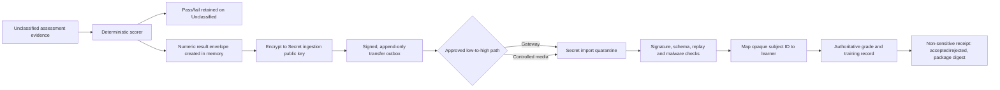
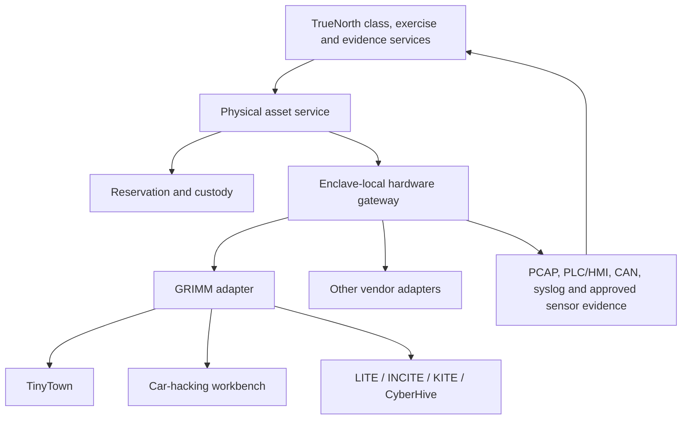

# COTE unclassified-first gap-closure plan

**Status:** Accepted delivery baseline; U1-Slice 1 foundation and enclave-profile gates implemented
**Target:** An evidence-backed 8.5/10 COTE fit for the Unclassified IOC, followed by
repeatable promotion into Secret and higher enclaves
**Planning source:** COTE PSOR Draft v1.0, especially HLMRs 1–7, IOC/FOC definitions,
effectiveness requirements and performance measures
**Code baseline reviewed:** `github/main` at `4c3f2559` (2026-10-23)
**Owner decisions incorporated:** Unclassified first; independent TN deployments in each
enclave; names and authoritative grades retained in Secret; Unclassified retains only an
opaque learner identity and pass/fail; numeric results move low-to-high through an approved
transfer path; physical ranges such as GRIMM TinyTown and car-hacking workbenches must be
integrated.

### Delivery update — 2026-10-23

The first code increment now implements the core of Epic 4: the signed and encrypted
result envelope, exact grade-free public projection, bounded controlled-media files,
Secret-only subject binding and authoritative imported-result ledger, linear corrections,
replay receipts and signed grade-free acknowledgements. Production now requires an explicit
classification and stable enclave ID in API startup, Compose and installer preflight, and the
configured ID is enforced on transfer routes. The focused suite is green. This is
a foundation rather than the completed gate: quiz, practical exercise and class close-out
producers do not yet call it; key custody and source trust enrollment are not installed;
quarantine/malware scanning and operator UI are not built; and the present Unclassified
application still has legacy readable score fields in its existing learning tables.

A schema inventory now ratchets 43 known Unclassified remediation findings across identity,
registration, roll call, quizzes, progress, exercises, Moodle results, acknowledgements and
collaboration. New direct identity/result columns fail tests unless explicitly reviewed. The
inventory is intentionally evidence of the remaining gap, not a compliance claim.

## 1. Outcome and boundary

This plan closes the product, infrastructure, content and evidence gaps needed for TN to
be a strong Unclassified COTE implementation. It does not call an Unclassified deployment
compliant with the PSOR's SECRET or TS/Special Access requirements. It creates the same
signed software and content baseline that can later be installed independently in those
enclaves and accredited there.

The score targets are:

| Milestone | Target | Meaning |
|---|---:|---|
| U0 — current evidence | 6.2/10 | Useful platform capabilities, with material operational and acceptance gaps |
| U1 — Unclassified IOC | **8.5/10** | Complete individual and limited collective training on real infrastructure, physical-device integration, measurable service levels, bilingual/accessibility baseline and accepted security evidence |
| S1 — Secret enclave | 8.5/10 for IOC scope | Independent Secret installation, authoritative identity and grade store, approved low-to-high results transfer and Secret accreditation evidence |
| F1 — COTE FOC | 8.5/10 overall | Multiple classified enclaves, sustained collective/mission-rehearsal capacity and demonstrated CAF/GC/allied interoperability |

An 8.5 rating means the behaviour has passed an acceptance journey in the intended
environment. A route, model, test double, simulator or planning document alone does not
earn the score.

## 2. Accepted architecture decisions

### 2.1 Independent enclave deployments

Each enclave receives an independent TN installation:

- independent databases, object storage, search/LRS, identity provider, keys and audit
  archive;
- no shared database, message broker, directory or runtime trust across classification
  boundaries;
- the same signed container digests and migration chain where the enclave authority accepts
  them;
- enclave-local configuration, secrets, identities, content approvals and retention;
- packages move between enclaves only through the approved transfer process; and
- failure or compromise in one enclave cannot authenticate to or administer another.

The deployment unit is an **Enclave Release Bundle** containing signed image manifests,
SBOMs, migrations, configuration schema, approved content packages, offline dependencies,
verification tooling and an installation/rollback record. Secrets and environment-specific
addresses are generated inside the destination enclave and are never copied in the bundle.

### 2.2 Identity and results split

Secret is the authority for learner identity, numeric grades, instructor comments,
assessment artifacts and the official training record. Unclassified operates with opaque,
random subject identifiers and keeps only the minimum result needed to run training.

| Information | Unclassified | Secret |
|---|---|---|
| Learner name, service number, unit identity | Prohibited | Authoritative |
| Mapping from person to training subject ID | Prohibited | Authoritative |
| Random training subject ID | Allowed | Mapped to the person |
| Course, release, objective and attempt identifiers | Allowed | Mirrored with provenance |
| Numeric/raw score | Never stored in readable form; produced only for sealed transfer | Authoritative |
| Pass/fail | Retained against the random subject ID | Retained with the official record |
| Instructor narrative and appeal material | Prohibited unless separately approved | Authoritative |
| Raw telemetry/evidence | Retained only when scrubbed and approved | Retained as policy permits |
| Transfer receipt and package digest | Allowed | Authoritative receipt |

The privacy and classification authority must approve this table. Pseudonymization reduces
exposure but does not by itself determine whether a record is Protected B.

### 2.3 Low-to-high result transfer

TN will not open a general network connection from Unclassified to Secret. It will implement
a transport-neutral result package that an approved one-way gateway or controlled-media
process can carry.

**Current transport assumption (2026-10-24):** a data diode is the leading candidate for
Unclassified-to-Secret delivery, subject to confirmation. The package contract remains
transport-neutral until the selected diode's ingress/egress interface, atomic file-delivery
semantics, size/rate limits, health signals, replay behaviour and accreditation constraints
are known. No reverse network channel is assumed.

Required properties:

1. The numeric result is encrypted to a Secret-held public-key recipient before it is
   persisted. Unclassified stores ciphertext, metadata and a digest, not a readable grade.
2. The envelope is signed by an Unclassified enclave result-signing key and binds enclave,
   tenant, subject, course release, assessment, attempt, scorer version, evidence digests,
   result, timestamp and unique event ID.
3. Secret verifies the trusted source key, schema version, content release, evidence digest,
   replay state and subject mapping before accepting it.
4. Duplicate import is idempotent. A correction creates a new superseding record; it never
   rewrites the original.
5. A receipt reports only package ID, digest, acceptance state and error category. It never
   returns the learner name or grade to Unclassified.
6. Logs, metrics, traces and support bundles never contain numeric grades, names or the
   Secret identity mapping.
7. The transport adapter supports an offline export/import path first. A cross-domain
   gateway adapter is added only after the security authority defines its interface.
8. An unacknowledged envelope remains retryable. Key rotation, lost media, duplicate media,
   out-of-order correction and destination outage are acceptance cases.

### 2.4 Physical cyber-range integration

GRIMM describes TinyTown as a 2-by-3-foot 3D-printed city with individually illuminated
cyber-physical assets. Its car-hacking workbenches use actual vehicle hardware. GRIMM's
LITE, INCITE, KITE and CyberHive products combine physical devices with engineering/HMI
systems, networks, VMs and courseware. TN must therefore treat them as reservable physical
training systems with companion compute, not as ordinary VMs.

No public GRIMM interface contract was found. Vendor discovery is a required first gate;
the plan does not assume that these products expose a supported control API.

Introduce a generic **Physical Training Asset Provider** boundary:

The core contract should expose:

- `inventory`: identity, model, capabilities, location, classification, ownership and state;
- `reserve`: exclusive/shared use, class/session, custodian and conflict handling;
- `prepare`: select companion VM release, load approved configuration and run preflight;
- `health`: controller, network, sensor, safety and companion-VM readiness;
- `start`, `pause`, `resume`, `stop`: only when the vendor supports safe automation;
- `access`: learner/team interfaces without exposing management credentials;
- `evidence`: typed, timestamped evidence with source and calibration metadata;
- `reset`: automated, guided-manual or vendor-maintained reset with verification;
- `release`: confirm safe state, evidence closure and custody handback; and
- `quarantine`: remove a failed or unsafe asset from scheduling without destroying history.

An adapter may legitimately implement reservation, health and evidence while declaring
start/reset as instructor-run manual steps. TN must display that truth rather than simulate
successful automation.

## 3. Definition of 8.5/10 for the Unclassified IOC

The Unclassified milestone is achieved only when all of these outcomes are demonstrated:

1. An approved individual course can be published, scheduled, delivered, assessed and
   completed by a named test cohort using pseudonymous TN identities.
2. A collective class can be scheduled, approved, split into teams, run on a shared range,
   observed live, closed out and reviewed through an AAR.
3. At least three representative environments run on a real writable vCenter: enterprise,
   cloud and OT/cyber-physical.
4. TinyTown or an equivalent physical ICS kit is reserved and used through TN; a
   car-hacking workbench follows the same adapter contract.
5. Numeric results are sealed and imported into a Secret-side test harness while
   Unclassified retains only pass/fail and an opaque subject ID.
6. Required class-size, concurrent-environment, recovery and endurance targets pass with
   retained reports.
7. English and French critical user journeys work, and accessibility testing covers the
   learner, instructor and administrator paths.
8. The Unclassified security authorization package has no open critical findings and its
   residual risks have owners and dates.
9. A second isolated TN deployment is installed from the same signed enclave bundle without
   using the source deployment's database, keys or secrets.
10. Every claimed PSOR measure maps to an owner, target, evidence artifact and acceptance
    result.

## 4. Delivery sequence

### Epic 0 — Establish the authoritative traceability baseline

**Purpose:** Turn the draft PSOR into a testable backlog without silently treating desired
features or narrative text as accepted requirements.

Deliverables:

- requirement IDs for every HLMR, IOC/FOC row, effectiveness requirement and performance
  measure;
- a matrix with `requirement → TN capability → acceptance test → evidence → owner → state`;
- agreed numeric targets for class size, concurrent environments, environment-ready time,
  availability, recovery, event completion and content refresh;
- an Unclassified information-classification table approved by privacy/security authorities;
- a dependency register for infrastructure, vendors, licences, SMEs and accreditors; and
- score calculation rules that cannot award points for unexecuted tests.

**Acceptance:** every U1 claim has a measurable test and every unavailable threshold is an
explicit decision, not an assumed value.

### Epic 1 — Finish classes, collective exercises and the two calendars

**Purpose:** Close the largest user-facing gap in HLMR 2.

Build and merge:

1. per-session individual and collective range allocation;
2. class-long range ownership with safe teardown;
3. balanced teams with instructor adjustment;
4. automatic attendance from sign-in plus range access, with audited correction;
5. close-out with pass/fail/incomplete, comment routing to Secret and immutable history;
6. Student **My classes** week/month view and Join readiness;
7. the Events calendar with capacity, approval queue and maintenance windows;
8. observer/unit readiness using only permitted Unclassified fields;
9. self-serve lab admission behind reserved class capacity; and
10. historical participation records so withdrawal/re-enrolment cannot erase AAR access.

Likely ownership:

- API: `app/classes/`, `app/class_setup/`, `app/scheduler/`, `app/live_class/`;
- range lifecycle: `app/lab_sessions/`, range leases and worker provisioners;
- web: Classes, Schedule, Calendar, Live Class and My Classes features;
- persistence: additive migrations for attendance, close-out and immutable participation;
- contract: OpenAPI and generated Angular types.

**Acceptance journey:** create a 15-person class, approve sessions, admit pseudonymous
learners, run four individual sessions and one collective exercise, correct one attendance
record, replace one team member, survive a browser restart, close the class and generate the
AAR without exposing another class or tenant.

### Epic 2 — Prove the virtual range on real infrastructure

**Purpose:** Convert HLMR 3 from simulator evidence into operational evidence.

Work:

- register a writable non-production vCenter and complete the existing live-lab journey;
- promote real golden-image builds and verify guest customization;
- deploy enterprise, cloud and OT templates end to end;
- enable real host telemetry collection rather than synthetic inject-only evidence;
- verify VLAN/port-group isolation, mirrored monitoring networks and controlled egress;
- exercise provision, reset, snapshot, restore, host loss, failed build, interrupted cleanup
  and reconciliation;
- implement N+1 capacity admission and maintenance-window behaviour; and
- retain signed range-certification exports for each candidate environment.

**Acceptance:** two students' individual labs plus one collective range build, operate,
reset and clean up on real vSphere. No orphan object, cross-range packet path, reusable
credential or false-ready state remains.

### Epic 3 — Add physical cyber-range assets

**Purpose:** Make TinyTown, automotive benches and future cyber-physical products first-class
training resources.

#### 3A. Vendor and safety discovery

Obtain from GRIMM for each selected kit:

- supported APIs, protocols, remote-management boundaries and authentication;
- companion VM images, licence terms and redistribution/offline rights;
- network diagram, ports, expected traffic and time synchronization;
- reset, calibration, firmware, maintenance and safe-state procedures;
- supported evidence sources and export formats;
- concurrency model and whether one kit supports multiple observers or active teams;
- warranty/support constraints on automated power or configuration control; and
- courseware integration and instructor qualification requirements.

Produce an interface-control document. No vendor-specific production code starts until
the interface and permitted automation are signed off.

#### 3B. Generic physical-asset service

Add dedicated models and contracts for assets, capabilities, reservations, sessions,
custody, preflight checks, evidence receipts, reset records and maintenance state. Reuse
scheduler capacity and class roll calls, but keep physical-resource state out of generic
VM tables.

#### 3C. Enclave-local hardware gateway

Run the gateway next to the kits. It accepts mutually authenticated jobs from TN, holds
vendor credentials locally, applies allowlisted operations, signs results and continues to
safe-stop if TN becomes unavailable. It never exposes a PLC engineering port, CAN interface
or vendor management credential to a learner network.

#### 3D. GRIMM pilot adapters

Implement in this order:

1. **TinyTown/ICS reservation and observation:** reserve, verify health, launch companion
   EWS/HMI VM, ingest approved network/PLC evidence, manual reset confirmation.
2. **TinyTown controlled actions:** only the actions GRIMM documents as remotely safe.
3. **Car-hacking workbench:** reserve one bench per team, start companion tooling, capture
   approved CAN/network evidence, enforce bench-only operation and verified reset.
4. Extend the same provider to LITE/INCITE/KITE/CyberHive without changing core TN flows.

**Acceptance:** two competing bookings cannot claim the same kit; a failed preflight blocks
Join; loss of TN does not leave an unsafe automated action running; a reset is verified;
evidence reaches the correct exercise/team/objective; another tenant cannot see or control
the asset.

### Epic 4 — Build the enclave release and results-transfer system

**Purpose:** Support repeatable copies of TN and the Unclassified-to-Secret record flow.

Modules:

- `enclave_releases`: signed offline bundle creation, inventory and verification;
- `result_transfer`: canonical envelope, encryption, signatures, outbox and receipts;
- `result_transfer_backends`: offline media first, gateway adapter later;
- `subject_registry`: Secret-side identity mapping only;
- import quarantine: schema, malware, signature, trust, replay and release validation; and
- administrative UI for pending, exported, received, rejected, retried and superseded
  packages without displaying numeric results on Unclassified.

Security properties:

- separate content-signing, software-release, audit and result-signing keys;
- Secret import trusts explicitly enrolled Unclassified enclave keys;
- ciphertext is bound to the intended destination and cannot be replayed to another enclave;
- packages have maximum size, count and age limits;
- parser and archive extraction run in confinement;
- every export, import, rejection and override is audited;
- no support export can include the Secret mapping or readable numeric result; and
- data-loss prevention tests scan application responses, logs, traces, exports and backups.

**Acceptance:** transfer 100 results containing duplicates, corrections, failures and
out-of-order packages. Secret produces exactly the intended official records; Unclassified
cannot decrypt a numeric grade or resolve a subject to a person.

### Epic 5 — Complete the Unclassified security baseline

**Purpose:** Raise HLMR 5 for the actual Unclassified threat model and prepare code for
later enclave accreditation.

Work:

- encrypt database, object-store, search, LRS and backup volumes at rest;
- encrypt or mutually authenticate service-to-service traffic;
- replace environment-only master secrets with an approved key-management boundary;
- use separate non-owner database roles and immutable/WORM audit export storage;
- close audit gaps for authentication outcomes, reads of sensitive records, source,
  outcome and correlation ID;
- add WebAuthn/smart-card integration if required by the Unclassified identity authority;
- qualify Windows AD DS/AD CS rather than relying only on Samba tests;
- complete vulnerability, patch, image-signing and offline dependency procedures;
- threat-model the physical gateway and result-transfer parsers;
- establish malware containment and exercise operating procedures; and
- produce an SSP/control matrix, POA&M and evidence index for authorization.

**Acceptance:** independent penetration test and tenant-boundary assessment have no open
critical/high findings; restore, key rotation, audit tamper detection and break-glass
procedures are rehearsed on the candidate environment.

### Epic 6 — Bilingual, accessible and inclusive operation

**Purpose:** Close explicit Government of Canada delivery gaps.

Work:

- add application localization with Canadian English and French as first-class locales;
- externalize UI, email, notification, report and error text;
- require bilingual metadata and delivery state for content that must be offered in both
  official languages;
- provide language preference through Moodle, cmi5 and xAPI;
- test keyboard-only, screen-reader, zoom/reflow, focus, contrast and non-colour status;
- provide alternatives for visual/physical-only TinyTown and vehicle tasks;
- document accommodation, evaluator and appeal workflows; and
- conduct an accessibility audit and GBA+ review with tracked remediation.

**Acceptance:** one individual and one collective journey pass in English and French with
keyboard and screen-reader evidence; automated checks are supporting evidence, not the
entire accessibility claim.

### Epic 7 — Reliability, scale and operations

**Purpose:** Prove that TN can sustain the Unclassified IOC workload.

Work:

- deploy highly available platform services or document the accepted single-node boundary;
- define and test RTO/RPO separately for platform, course content, evidence and ranges;
- run real 200-user load, then 500 and 1,200-user stress/soak tests where required;
- test concurrent environment capacity using real provisioned workloads, not API calls alone;
- instrument environment-ready time, event completion, recovery, throughput, queue delay,
  evidence latency and cleanup;
- implement alert delivery and on-call response, not only alert-rule unit tests;
- conduct host, storage, network, worker, database, search/LRS and gateway failure exercises;
- establish capacity pods and admission control for future 70,000-vCPU growth; and
- publish measured limits, headroom and degradation behaviour.

**Acceptance:** a 72-hour rehearsal at intended IOC concurrency remains within agreed
latency/error/saturation thresholds and passes restore plus one injected infrastructure
failure. Results and raw reports are retained with the candidate release.

### Epic 8 — Content, assessment and readiness evidence

**Purpose:** Replace test content with an operationally defensible training programme.

Work:

- obtain authoritative curricula, QSP/CFITES mappings, course outcomes and source rights;
- assign SMEs, instructional designers, assessors and maintainers;
- finish and review the three pilots, then produce course waves using measured effort;
- add cloud, ICS/OT, cyber-physical and automotive pathways;
- bind each scored objective to authoritative evidence and validator versions;
- calibrate instructors and assessors, including manual physical-kit observations;
- implement re-assessment, appeal, accommodation and result-correction processes;
- run the content-review release/KEV/NVD feeds online and by signed offline bundle; and
- measure the PSOR assumption that 20 percent of content changes annually.

**Acceptance:** every released IOC course has an approved owner, source dossier, bilingual
state, assessment blueprint, environment profile, instructor guide, learner trial, evidence
map, review date and rollback version.

### Epic 9 — Interoperability demonstration

**Purpose:** Turn standards support into evidence for HLMR 7.

Work:

- retain Moodle 5.2.3, CATAPULT cmi5 and xAPI conformance gates;
- define a portable exercise/content/result exchange profile;
- exercise federation with one CAF/DND system or approved surrogate;
- demonstrate a joint exercise with a second independently operated TN installation;
- test identity, roster, calendar, content, telemetry, AAR and result exchange separately;
- enforce release and information-sharing policy on every exported artifact; and
- add partner-specific adapters only behind the generic integration contracts.

**Acceptance:** a partner imports an approved exercise package, runs assigned participants,
returns permitted evidence and reconciles the result without shared administration,
cross-tenant disclosure or manual database editing.

## 5. Release gates and sequence

| Gate | Entry dependency | Exit evidence |
|---|---|---|
| G0 — Requirements accepted | Epic 0 | Signed traceability matrix, metrics and data rules |
| G1 — Complete user journeys | Epic 1 | Browser/API/worker journeys for individual and collective classes |
| G2 — Real range | Epic 2 | Real-vCenter certification records and failure drills |
| G3 — Physical pilot | Epic 3A–3D | TinyTown/ICS and automotive adapter acceptance evidence |
| G4 — Enclave portability | Epic 4 | Clean second installation plus sealed result-transfer exercise |
| G5 — Security candidate | Epic 5 | Authorization evidence, penetration report and closed critical/high findings |
| G6 — Service candidate | Epics 6–8 | Bilingual/accessibility, scale, operations and approved course evidence |
| G7 — Unclassified IOC | All above | PSOR traceability report scoring at least 8.5 with no unevidenced mandatory claim |
| G8 — Secret pilot | G4 and Secret infrastructure | Independent accreditation and live low-to-high result acceptance |
| G9 — FOC growth | G8 and Epic 9 | Classified concurrency, mission rehearsal and allied/GC interoperability |

Epics 0 and vendor discovery can start immediately. Epic 1 and real-vCenter preparation can
run in parallel once file ownership is separated. The results envelope can be designed and
tested against two local isolated deployments before any cross-domain product is selected.

## 6. Score progression

| HLMR | Current | U1 target | Evidence that earns the target |
|---|---:|---:|---|
| 1 Individual training | 7.5 | 9.0 | Approved bilingual courses, real learner trials, authoritative evidence and Secret result import |
| 2 Collective training | 6.0 | 8.5 | Complete class/session/team/attendance/close-out journey and collective exercise rehearsal |
| 3 Simulated environments | 6.0 | 8.5 | Enterprise/cloud/OT on real vSphere plus one integrated physical range and measured concurrency |
| 4 Connectivity | 7.0 | 8.5 | Reliable remote access, consoles, degraded-network behaviour and physical-gateway operation |
| 5 Security | 4.0 overall; stronger for application controls | 8.0 for Unclassified | Accepted Unclassified controls, encrypted storage/traffic, independent assessment and enclave-transfer evidence |
| 6 Agility | 7.5 | 9.0 | Complete content clock/feeds, portable signed bundles and measured refresh workflow |
| 7 Interoperability | 5.5 | 8.0 | Real second-system exchange plus existing Moodle/cmi5/xAPI proof |

This produces an Unclassified IOC score above 8.5 while leaving the classified-operation
portion of HLMR 5 explicitly open for the Secret and TS/Special Access milestones.

## 7. Programme evidence pack

Every release candidate must produce one indexed package containing:

- requirement traceability and score calculation;
- signed source and container release manifest with SBOMs;
- clean-install, upgrade, rollback and second-enclave installation records;
- unit, integration, browser, Moodle, cmi5, vSphere, physical-device and load results;
- range-certification records and isolation tests;
- result-transfer exports, receipts and replay/correction evidence using synthetic learners;
- security assessment, vulnerability results, control matrix and accepted risks;
- accessibility, bilingual and GBA+ findings;
- backup, restore, key rotation and failure-exercise records;
- course approval, source, assessment and learner-trial evidence; and
- limitations stated as limitations rather than converted into passing claims.

## 8. Immediate delivery increments

### U1-Slice 1 — classification-safe result foundation

Implement and verify the Epic 4 contract before connecting any scoring producer:

1. signed, destination-bound encryption of numeric results to the Secret recipient key;
2. exact Unclassified projection containing an opaque subject token and pass/fail;
3. durable ciphertext-only outbox and bounded controlled-media export/import;
4. Secret-only subject mapping and authoritative numeric-result ledger;
5. replay/idempotency, linear corrections and signed grade-free receipts; and
6. adversarial privacy, tamper, wrong-key, wrong-route, duplicate and migration tests.

The cryptographic, media and persistence foundation is implemented on
`codex/cote-result-transfer`. Remaining work for this slice is producer integration, real key
custody and trust enrollment, import quarantine, operator workflows and proof that no legacy
Unclassified learning table, response, log or export retains a readable numeric grade.

### U1-Slice 2 — complete one class from booking to close-out

Rebase the per-session-range work onto the accepted baseline; add immutable participation,
attendance and close-out; finish individual/collective allocation and teams; deliver My
Classes and Events calendar journeys; and have close-out emit the result contract. The slice
passes only when the synthetic 15-person class journey, tenant/role boundaries, generated
contracts and repository DoD are green.

## 9. External references used for the physical-range scope

- GRIMM product catalogue: <https://grimmcyber.com/product-catalog/>
- GRIMM catalogue PDF: <https://grimmcyber.com/wp-content/uploads/2024/07/PRODUCT-CATALOG-GRIMM.pdf>
- GRIMM technical training: <https://grimmcyber.com/services/technical-training-and-education/>

The published descriptions establish the training purpose and presence of real hardware,
companion VMs and courseware. They do not establish an API, protocol, licensing right or
remote-control capability; those remain vendor-discovery outputs.
