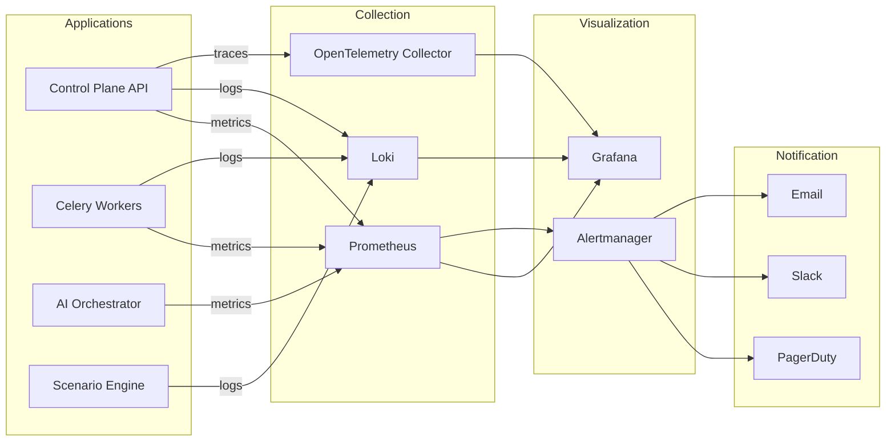

# TrueNorth Range — Operations Guide

> Day-to-day operations, monitoring, alerting, backup/restore, scaling, and disaster-recovery runbooks for production TrueNorth Range deployments.

---

## Table of Contents

- [Daily Operations Checklist](#daily-operations-checklist)
- [Monitoring Architecture](#monitoring-architecture)
- [Dashboard Reference](#dashboard-reference)
- [Alert Response Procedures](#alert-response-procedures)
- [Backup and Restore](#backup-and-restore)
- [Database Maintenance](#database-maintenance)
- [Scaling Operations](#scaling-operations)
- [Log Management](#log-management)
- [Certificate Management](#certificate-management)
- [Disaster Recovery](#disaster-recovery)
- [Runbook: Common Issues](#runbook-common-issues)
  - [Range leases, abandon and recovery](#range-leases-abandon-and-recovery)
- [Capacity Planning](#capacity-planning)
- [Change Management](#change-management)

---

## Daily Operations Checklist

### Morning Health Check (~10 minutes)

| # | Task | Command / Action | Expected Result |
|---|------|-----------------|----------------|
| 1 | Check API health | `curl https://api.truenorth.local/healthz` | `{"status": "healthy"}` |
| 2 | Check Worker health | `celery -A celery_app inspect ping` | All workers respond |
| 3 | Check PostgreSQL | `pg_isready -h db.truenorth.local` | `accepting connections` |
| 4 | Check Redis | `redis-cli -h redis.truenorth.local ping` | `PONG` |
| 5 | Check OpenSearch | `curl https://opensearch.truenorth.local:9200/_cluster/health` | `"status": "green"` |
| 6 | Check MinIO | `mc admin info truenorth-minio` | All nodes online |
| 7 | Check Keycloak | `curl https://auth.truenorth.local/health/ready` | `{"status": "UP"}` |
| 8 | Check AI Orchestrator | `curl http://ai-orchestrator:6000/health` | `{"status": "ok"}` |
| 9 | Review active ranges | Dashboard: Active Ranges panel | No stuck states |
| 10 | Review error logs | Grafana Loki: `{app="truenorth"} |= "ERROR"` last 24h | No unexpected errors |

### Weekly Maintenance (~30 minutes)

| Task | When | Procedure |
|------|------|-----------|
| Database vacuum | Sunday 02:00 UTC | Automated via cron; verify completion |
| Certificate expiry check | Monday | `openssl x509 -enddate -noout -in /etc/ssl/truenorth.crt` |
| Disk usage review | Monday | `df -h` on all nodes; alert if >80% |
| Backup verification | Tuesday | Restore latest backup to test environment |
| Security scan | Wednesday | Run Trivy against container images |
| Log rotation verify | Thursday | Check logrotate ran successfully |
| Dependency update review | Friday | Check for CVEs in dependencies |

### Monthly Tasks

| Task | Procedure |
|------|-----------|
| Load test | Run k6 load test against staging |
| DR drill | Execute disaster recovery runbook |
| Access review | Audit Keycloak user accounts and role assignments |
| Capacity review | Review Grafana trends for growth planning |
| Packer image rebuild | Rebuild base images with latest OS patches |

---

## Monitoring Architecture



### Metrics Endpoints

| Service | Metrics URL | Port |
|---------|------------|------|
| Control Plane API | `/metrics` | 8080 |
| Celery Workers | `/metrics` (flower) | 5555 |
| AI Orchestrator | `/metrics` | 6000 |
| PostgreSQL | postgres_exporter | 9187 |
| Redis | redis_exporter | 9121 |
| OpenSearch, Moodle, ARC² runner | host probes → node_exporter textfile (`truenorth_probes.prom`) | 9100 |
| Backups | `backup.sh` → node_exporter textfile (`truenorth_backup.prom`) | 9100 |
| MinIO | `/minio/v2/metrics/cluster` | 9000 |
| Node Exporter | `/metrics` | 9100 |

---

## Dashboard Reference

### 1. Platform Overview Dashboard

**Purpose:** High-level health and throughput.

| Panel | Metric | Thresholds |
|-------|--------|-----------|
| API Request Rate | `rate(http_requests_total[5m])` | Warn: >500 rps |
| API Latency P99 | `histogram_quantile(0.99, ...)` | Warn: >500ms, Crit: >2s |
| Error Rate | `rate(http_requests_total{status=~"5.."}[5m])` | Warn: >1%, Crit: >5% |
| Active Ranges | `truenorth_ranges_active` | Info only |
| Active Exercises | `truenorth_exercises_active` | Info only |
| Celery Queue Depth | `celery_queue_length` | Warn: >100, Crit: >500 |

### 2. Infrastructure Dashboard

| Panel | Metric | Thresholds |
|-------|--------|-----------|
| CPU Usage | `node_cpu_seconds_total` | Warn: >80%, Crit: >95% |
| Memory Usage | `node_memory_MemAvailable_bytes` | Warn: <20%, Crit: <5% |
| Disk Usage | `node_filesystem_avail_bytes` | Warn: >80%, Crit: >90% |
| PostgreSQL Connections | `pg_stat_activity_count` | Warn: >80% of max |
| Redis Memory | `redis_memory_used_bytes` | Warn: >80% of maxmemory |
| OpenSearch Cluster Health | `truenorth_opensearch_cluster_status{color=...}` | Warn: yellow 15 min, Crit: red |

### 3. Provisioning Dashboard

| Panel | Metric | Thresholds |
|-------|--------|-----------|
| Provision Duration | `truenorth_provision_duration_seconds` | Warn: >10min, Crit: >30min |
| Provision Success Rate | `truenorth_provision_total{status="success"}` | Crit: <95% |
| Active Terraform Runs | `truenorth_terraform_active` | Warn: >10 concurrent |
| VM Count by State | `truenorth_vms_by_state` | Info only |
| Destroy Duration | `truenorth_destroy_duration_seconds` | Warn: >5min |

### 4. AI Orchestrator Dashboard

| Panel | Metric | Thresholds |
|-------|--------|-----------|
| AI Request Rate | `ai_requests_total` | Info only |
| AI Latency P95 | `ai_request_duration_seconds` | Warn: >5s, Crit: >30s |
| Backend Availability | `ai_backend_healthy` | Crit: any backend down |
| Token Usage | `ai_tokens_total` | Info (cost tracking) |
| Queue Depth | `ai_queue_depth` | Warn: >50 |

---

## Alert Response Procedures

### Alert delivery

An alert nobody receives is not monitoring. Out of the box Alertmanager routes every alert
to a `null` receiver; the installer warns about it in `30-config` and in the `99-validate`
report (`alerts: NOWHERE (null receiver)`, `WARNING: ALERTS ARE NOT DELIVERED`).

Delivery is by **email** (install/README.md "Alerting" has every variable):

- Turn it on with `tn_alert_email_enabled: true` (off on staging until the SMTP details are known), the recipient
  (`tn_alert_email_to`), sender (`tn_alert_email_from`) and relay (`tn_alert_smtp_host`,
  port `587`, STARTTLS required), and the relay account in the vault
  (`vault_alert_smtp_username`, `vault_alert_smtp_password`). Preflight refuses
  placeholders and gaps. Re-run `30-config` and `50-stack-up`.
- Criticals are mailed at once and hourly while they fire; warnings are batched (first
  after 5 minutes, then at most every 15 minutes) and repeat every 12 hours; each alert
  is followed by a RESOLVED message. Subjects start `[TrueNorth <host>]`.
- The SMTP password lives only in `/srv/truenorth/config/alertmanager/smtp_password`
  (0600, read with `smtp_auth_password_file`). To rotate it: change the vault value,
  re-run `30-config` (Alertmanager restarts on its own), then run the delivery test.

**Prove it after every change** (recipient, relay, credential, upgrade): the
`tn-alert-test` path fires a synthetic critical `TrueNorthAlertTest` and fails if
Alertmanager could not hand it to the relay.

```bash
cd install && ansible-playbook -i inventory/staging.yml playbooks/alert-test.yml --ask-vault-pass
```

`SENT` means the relay accepted the message, not that it arrived: delivery is proven
when the FIRING message, and about 5 minutes later the RESOLVED one, are in the inbox.
Record the times and mailbox as the evidence. If it fails, `docker logs --since 5m
tn-alertmanager` names the SMTP error (authentication, TLS, a sender the relay refuses);
`docker exec tn-alertmanager amtool check-config /etc/alertmanager/alertmanager.yml`
checks the config Alertmanager is running.

### Alert Rules

What Prometheus actually alerts on: `infra/platform/docker/monitoring/prometheus/alerts.yml`
(unit tests in `alerts.test.yml`; `tests/contracts/test_prometheus_rules.py` runs promtool
and keeps this table and the file in step). Alertmanager routes them
(`monitoring/alertmanager/`).

Some components have no exporter, so the host reports on them through node_exporter's
textfile collector (`$TN_DATA_ROOT/metrics`): `scripts/backup/backup.sh` writes
`truenorth_backup.prom` after every run, and `scripts/monitoring/host-probes.sh`
(cron, every minute; installed with the backup cron) writes `truenorth_probes.prom`:
OpenSearch's `_cluster/health`, the Moodle node's container health (only with
`tn_moodle_enabled`) and `systemctl is-active truenorth-arc2-runner` (only with
`tn_arc2_enabled`). A component that is not installed writes no series and cannot alert.

| Alert | Severity | Fires when |
|---|---|---|
| `HighCpuUsage` | warning | CPU > 80% for 5 min |
| `HighMemoryUsage` | warning | memory > 85% for 5 min |
| `DiskSpaceHigh` | warning | a filesystem > 80% for 10 min |
| `NodeDown` | critical | node_exporter unreachable for 1 min |
| `ApiHighErrorRate` | critical | API 5xx > 5% for 5 min |
| `ApiHighLatencyP95` | warning | API p95 > 1 s for 5 min (health probes and unmatched paths excluded) |
| `ApiTooManyRateLimits` | warning | > 10 429s/s for 5 min |
| `CeleryHighTaskFailureRate` | critical | task failures > 10% for 5 min |
| `CeleryProvisionQueueDeep` | warning | provision queue > 100 for 5 min |
| `CeleryDeadWorkers` | critical | a worker offline for 2 min |
| `PgConnectionPoolExhaustion` | critical | connections > 90% of max for 5 min |
| `PgHighLockWaits` | warning | > 20 exclusive locks for 5 min |
| `PgReplicationLag` | critical | replication lag > 30 s for 5 min |
| `RedisHighMemory` | warning | Redis memory > 80% for 5 min |
| `RedisConnectionErrors` | critical | Redis rejects connections |
| `RedisPubSubBacklog` | warning | > 1000 pub/sub channels + patterns |
| `HighProvisionFailureRate` | critical | range provisioning failures > 10% for 10 min |
| `SlowProvisionTime` | warning | provisioning p95 > 5 min |
| `StuckRanges` | critical | a range provisioning for > 15 min |
| `HostProbesStale` | warning | `truenorth_probes.prom` not refreshed for 10 min (the next four are blind) |
| `OpenSearchUnreachable` | critical | `_cluster/health` does not answer for 5 min |
| `OpenSearchClusterRed` | critical | cluster health red for 2 min |
| `OpenSearchClusterYellow` | warning | cluster health yellow for 15 min |
| `MoodleDown` | critical | the Moodle container is not running or unhealthy for 10 min |
| `Arc2RunnerDown` | warning | `truenorth-arc2-runner` not active for 5 min |
| `BackupFailed` | critical | the last `backup.sh` run kept no backup |
| `BackupIncomplete` | warning | the last backup kept the data but exited 3 (no escrow), 5 (telemetry snapshot failed) or 6 |
| `AuditArchiveTampered` | critical | `truenorth_backup_audit_verified` is 0: the last backup found that the signed audit export archive does not verify (signature, hash, chain or recorded export). A security event: docs/runbooks/backup-restore.md |
| `BackupStale` | critical | no good backup for more than 26 h (seeded at install, so a cron that never runs alerts too) |
| `BreakGlassAccountUsed` | critical | the local break-glass account signed in to TrueNorth within the last hour (`truenorth_break_glass_sign_ins_total`; ADR 0014 §6). Check it was planned: docs/runbooks/break-glass.md |

There is no WebSocket-connection alert: the API's `active_websocket_connections` gauge is
not maintained, and each of the API's uvicorn workers keeps its own registry, so a scrape
would see one worker's sockets at most. Watch WebSocket trouble in the logs (below).

### Critical Alerts

#### CRIT: API 5xx Rate > 5%

```
Severity: Critical
Condition: rate(http_requests_total{status=~"5.."}[5m]) / rate(http_requests_total[5m]) > 0.05
```

**Response:**
1. Check API logs: `kubectl logs -l app=truenorth-api --tail=100`
2. Check database connectivity: `pg_isready`
3. Check Redis: `redis-cli ping`
4. If DB issue: Check connection pool: `SELECT count(*) FROM pg_stat_activity;`
5. If Redis issue: Check memory: `redis-cli info memory`
6. If code issue: Roll back to previous deployment
7. Escalate if not resolved in 15 minutes

#### CRIT: PostgreSQL Down

```
Severity: Critical
Condition: pg_up == 0
```

**Response:**
1. Check PostgreSQL service: `systemctl status postgresql`
2. Check disk space: `df -h /var/lib/postgresql`
3. Check logs: `journalctl -u postgresql --since "10 minutes ago"`
4. If OOM: Increase `shared_buffers` or add memory
5. If disk full: Emergency cleanup or expand volume
6. If corruption: Initiate failover to replica
7. Notify all teams — this affects all services

#### CRIT: OpenSearch Cluster Red

**Response:**
1. Check cluster health: `curl localhost:9200/_cluster/health?pretty`
2. Identify unassigned shards: `curl localhost:9200/_cat/shards?v&h=index,shard,state,unassigned.reason`
3. Check node status: `curl localhost:9200/_cat/nodes?v`
4. If node down: Restart node, wait for shard recovery
5. If disk full: Clear old indices: `curl -X DELETE localhost:9200/tn-range-*-2024.01.*`
6. If persistent: Enable shard allocation: `curl -X PUT localhost:9200/_cluster/settings -d '{"persistent":{"cluster.routing.allocation.enable":"all"}}'`

### Warning Alerts

#### WARN: Celery Queue Depth > 100

**Response:**
1. Check worker status: `celery -A celery_app inspect active`
2. Check for stuck tasks: `celery -A celery_app inspect reserved`
3. If workers are healthy: Scale workers `kubectl scale deployment celery-worker --replicas=N`
4. If tasks stuck: Purge and retry: `celery -A celery_app purge`
5. Monitor queue depth returning to normal

#### WARN: OpenSearch Cluster Yellow

The platform's single node runs `cluster.default_number_of_replicas=0`, so yellow means an
index asks for replicas a single node cannot place.
1. Find it: `curl localhost:9200/_cat/indices?v&health=yellow`
2. Set its replicas to 0: `curl -X PUT localhost:9200/<index>/_settings -d '{"index":{"number_of_replicas":0}}'`

#### WARN: ARC² Runner Down

1. `systemctl status truenorth-arc2-runner` and `journalctl -u truenorth-arc2-runner -n 100`
2. Exit 2 means no usable sandbox (fail closed) and 3 another runner holds the runs root;
   neither heals by restarting (docs/arc2-course-studio.md "Deployment").
3. Otherwise `sudo systemctl restart truenorth-arc2-runner`. Studio jobs queued meanwhile
   run when it is back.

#### CRIT: Moodle Down

1. `docker compose -f compose.moodle-prod.yml --env-file $TN_CONFIG_DIR/moodle-<node>.env ps`
   and `... logs --tail 100 moodle`
2. A first install or upgrade stays `starting` for up to 20 minutes; that is not down.
3. See [runbooks/moodle.md](runbooks/moodle.md).

#### CRIT: Backup Failed / Stale

1. Read `$TN_DATA_ROOT/logs/backup.log`: the `[ALERT]` line names the failed step.
2. `BackupStale` with no failure logged: the `truenorth-backup` cron job is not running
   (`crontab -l` as the install user).
3. Fix the cause and run the backup by hand: `set -a; . $TN_DATA_ROOT/config/backup.env; set +a;
   scripts/backup/cron-backup.sh` ([runbooks/backup-restore.md](runbooks/backup-restore.md)).

#### WARN: Disk Usage > 80%

**Response:**
1. Identify large directories: `du -sh /* | sort -rh | head -20`
2. Clean Docker images: `docker system prune -a`
3. Rotate/compress old logs: `logrotate -f /etc/logrotate.d/truenorth`
4. Clean old OpenSearch indices (per retention policy)
5. Clean old MinIO artifacts
6. If persistent: Expand volume

---

## Backup and Restore

The full procedure, including what the operator must configure, is
[runbooks/backup-restore.md](runbooks/backup-restore.md). The scripts are in
`scripts/backup/`; `scripts/backup/drill.sh` proves them end to end (CI:
`.github/workflows/backup-drill.yml`, nightly and on every change to them).

### What is backed up

| Component | Method | Frequency | Retention |
|-----------|--------|-----------|-----------|
| PostgreSQL — every database on the server (app `${POSTGRES_DB}`, `keycloak`, `lrs`, ...) | `pg_dump -Fc` per database + `pg_dumpall --globals-only` (roles) | Nightly (`cron-backup.sh`) | 7 daily / 4 weekly / 12 monthly |
| MinIO — every bucket | `mc mirror` from a container of the stack's pinned MinIO image | Nightly | same |
| Env file (holds `TN_SECRETS_KEY` and every credential) | AES-256, data key wrapped to the escrow RSA public key | Nightly | same |
| OpenSearch (telemetry indices) | Snapshot into the `tn_snapshots` filesystem repository (`/srv/truenorth/opensearch-snapshots`), set up by the installer | Nightly | newest 14 snapshots (`tn_opensearch_snapshot_keep`) |
| Audit export archive (`AUDIT_ARCHIVE_PATH`, `/srv/truenorth/audit-archive`) | Copied whole; every Ed25519 signature and file hash verified with OpenSSL (exit 6 if not) | Nightly | same; the live archive is never pruned by TrueNorth |
| Redis | Not backed up: broker, cache, rate limits. Restoring it would replay stale tasks | — | — |
| Configuration | Git repository (the manifest records the commit) | Every commit | indefinite |

A backup is a directory `truenorth-backup-<UTC>/` with `postgres/<db>.dump`,
`postgres/globals.sql`, `minio/<bucket>/`, `secrets/env.enc` + `secrets/env.key.enc`,
`manifest.json` and `SHA256SUMS`. It is written under `.partial-…` and renamed only
when complete, so a directory with that name is always a whole backup.

### Audit log export and retention (ADR 0011)

Two beat entries run on worker-scenario (queue `default`), the only service with
`AUDIT_SIGNING_SEED` and the archive volume:

| Beat entry | When (UTC) | Does |
|---|---|---|
| `audit-export-daily` (`worker.audit_tasks.export_audit_days`) | 00:45 | Signs and writes every finished day not yet exported to `AUDIT_ARCHIVE_PATH` (catches up after downtime); recounts the day before yesterday and writes a supplement for late commits (`AUDIT_EXPORT_MISMATCH` in the log) |
| `audit-retention-daily` (`worker.audit_tasks.enforce_audit_retention`) | 02:15 | Deletes audit rows older than `AUDIT_HOT_RETENTION_DAYS` (90; floor 30; 0 = never), one day at a time and only after that day's export verifies; stops and logs `AUDIT_RETENTION_STOPPED` at the first day that does not |

`/health/deep` reports `audit_export` **degraded** when the newest export is older than the
day before yesterday while older rows exist: check worker-scenario's log, its
`AUDIT_SIGNING_SEED` (32+ characters) and that `AUDIT_ARCHIVE_PATH` is writable by uid 10001.
Verify the archive by hand:
`docker compose ... run --rm --no-deps worker-scenario python -m worker.audit_verify --db`.
The install report prints the signing key fingerprint (`python -m worker.audit_signing`);
keep it outside the host.

### Restore

```bash
cd /opt/truenorth            # the app checkout
set -a; . /etc/truenorth/backup.env; set +a      # COMPOSE_FILE, ENV_FILE, BACKUP_DIR
scripts/backup/restore.sh "$BACKUP_DIR/daily/truenorth-backup-20261008T021700Z"
```

`restore.sh` verifies the checksums (and that the backup's OpenSearch snapshot still
exists), asks for the compose project name, stops every service except `postgres`,
`minio` and (for a snapshot) `opensearch`, re-creates roles, drops and re-creates each
database from its dump (`pg_restore --create`), re-creates each bucket and mirrors its
objects back, replaces the telemetry indices from the snapshot, then starts the stopped
services again. Verify with the row counts in the
runbook. If the code is newer than the backup, run migrations
([runbooks/upgrade.md](runbooks/upgrade.md)).

### OpenSearch

`compose.prod.yml` sets `path.repo` on a bind of `$TN_DATA_ROOT/opensearch-snapshots`;
the installer registers the repository `tn_snapshots` there (`70-telemetry`) and names it
in `backup.env`, so each nightly backup snapshots the telemetry indices and the manifest
names the snapshot. The snapshots stay in that directory, not in the backup directory:
copy it off the host with the backups. A failed snapshot does not cost the rest of the
backup: the database dumps, buckets and escrow are kept, the manifest records
`"status":"failed"`, an alert is raised and `backup.sh` / `cron-backup.sh` exit **5**;
`restore.sh` restores such a backup without its telemetry. Set
`tn_opensearch_snapshot_repo: ""` to leave telemetry out (scores, AARs and course records
are in PostgreSQL and MinIO either way). Details:
[runbooks/backup-restore.md](runbooks/backup-restore.md#opensearch).

---

## Database Maintenance

### PostgreSQL Maintenance

#### Automated VACUUM

```sql
-- Check tables needing vacuum
SELECT schemaname, relname, last_vacuum, last_autovacuum, n_dead_tup
FROM pg_stat_user_tables
ORDER BY n_dead_tup DESC;

-- Manual vacuum for large tables (run during low-traffic window)
VACUUM (VERBOSE, ANALYZE) ranges;
VACUUM (VERBOSE, ANALYZE) exercises;
VACUUM (VERBOSE, ANALYZE) audit_logs;
```

#### Index Maintenance

```sql
-- Check index usage
SELECT
  indexrelname,
  idx_scan,
  idx_tup_read,
  idx_tup_fetch,
  pg_size_pretty(pg_relation_size(indexrelid)) AS index_size
FROM pg_stat_user_indexes
ORDER BY idx_scan ASC;

-- Reindex bloated indexes (run during maintenance window)
REINDEX INDEX CONCURRENTLY idx_ranges_tenant;
REINDEX INDEX CONCURRENTLY idx_exercises_range;

-- Check for unused indexes (candidates for removal)
SELECT indexrelname, idx_scan
FROM pg_stat_user_indexes
WHERE idx_scan = 0 AND indexrelname NOT LIKE 'pk_%';
```

#### Connection Pool Monitoring

```sql
-- Current connections by state
SELECT state, count(*)
FROM pg_stat_activity
WHERE datname = 'truenorth_db'
GROUP BY state;

-- Kill long-running queries (> 5 minutes)
SELECT pg_terminate_backend(pid)
FROM pg_stat_activity
WHERE state = 'active'
  AND query_start < now() - interval '5 minutes'
  AND query NOT LIKE '%pg_stat%';
```

### OpenSearch Maintenance

#### Index Lifecycle Management

```bash
# Create ILM policy
curl -X PUT "localhost:9200/_plugins/_ism/policies/truenorth-ilm" -d '{
  "policy": {
    "description": "TrueNorth Range index lifecycle",
    "default_state": "hot",
    "states": [
      {
        "name": "hot",
        "actions": [],
        "transitions": [
          {"state_name": "warm", "conditions": {"min_index_age": "7d"}}
        ]
      },
      {
        "name": "warm",
        "actions": [{"force_merge": {"max_num_segments": 1}}],
        "transitions": [
          {"state_name": "delete", "conditions": {"min_index_age": "30d"}}
        ]
      },
      {
        "name": "delete",
        "actions": [{"delete": {}}],
        "transitions": []
      }
    ]
  }
}'
```

---

## Scaling Operations

### Horizontal Scaling Guide

| Component | Scale Trigger | Scale Action | Max Recommended |
|-----------|--------------|-------------|-----------------|
| API Replicas | CPU >70% or P99 >500ms | Add replica | 10 replicas |
| Celery Workers | Queue >100 for 5 min | Add worker | 20 workers |
| OpenSearch | Disk >70% or CPU >80% | Add data node | 12 nodes |
| PostgreSQL | Connection >80% | Add PgBouncer | 1 primary + 3 read replicas |
| Redis | Memory >80% | Scale vertically | 64GB RAM |
| AI Orchestrator | Queue >50 | Add replica | 5 replicas |

### Kubernetes Autoscaling

```yaml
# HPA for Control Plane API
apiVersion: autoscaling/v2
kind: HorizontalPodAutoscaler
metadata:
  name: truenorth-api
spec:
  scaleTargetRef:
    apiVersion: apps/v1
    kind: Deployment
    name: truenorth-api
  minReplicas: 3
  maxReplicas: 10
  metrics:
    - type: Resource
      resource:
        name: cpu
        target:
          type: Utilization
          averageUtilization: 70
    - type: Pods
      pods:
        metric:
          name: http_request_duration_seconds_p99
        target:
          type: AverageValue
          averageValue: "500m"

---
# HPA for Celery Workers
apiVersion: autoscaling/v2
kind: HorizontalPodAutoscaler
metadata:
  name: celery-worker
spec:
  scaleTargetRef:
    apiVersion: apps/v1
    kind: Deployment
    name: celery-worker
  minReplicas: 2
  maxReplicas: 20
  metrics:
    - type: External
      external:
        metric:
          name: celery_queue_length
        target:
          type: Value
          value: "100"
```

### Manual Scaling Commands

```bash
# Scale API replicas
kubectl scale deployment truenorth-api --replicas=5

# Scale Celery workers
kubectl scale deployment celery-worker --replicas=8

# Scale AI Orchestrator
kubectl scale deployment ai-orchestrator --replicas=3

# Add OpenSearch data node
helm upgrade opensearch opensearch/opensearch \
  --set replicas=5

# Verify scaling
kubectl get pods -l app.kubernetes.io/part-of=truenorth
```

---

## Log Management

### Log Locations

| Component | Location | Format |
|-----------|----------|--------|
| API | stdout → Loki | JSON structured |
| Celery Workers | stdout → Loki | JSON structured |
| AI Orchestrator | stdout → Loki | JSON structured |
| Scenario Engine | stdout → Loki | JSON structured |
| PostgreSQL | `/var/log/postgresql/` | PostgreSQL log format |
| Nginx | `/var/log/nginx/` | Combined log format |
| Keycloak | stdout → Loki | JSON structured |

### Log Query Examples (Loki/LogQL)

```logql
# All errors in last hour
{app="truenorth"} |= "ERROR" | json | line_format "{{.timestamp}} {{.message}}"

# Provisioning failures
{app="truenorth", component="worker"} |= "provision" |= "failed"

# Slow API requests (> 1s)
{app="truenorth", component="api"} | json | duration > 1s

# WebSocket disconnections
{app="truenorth", component="api"} |= "websocket" |= "disconnect"

# AI Orchestrator errors by backend
{app="truenorth", component="ai-orchestrator"} |= "ERROR" | json | line_format "{{.backend}}: {{.message}}"

# Audit log entries for a specific tenant
{app="truenorth"} | json | component="audit" | tenant_id="<uuid>"
```

### Log Retention Policy

| Log Type | Hot (Loki) | Warm (S3) | Total Retention |
|----------|-----------|-----------|-----------------|
| Application | 7 days | 90 days | 90 days |
| Audit | 30 days | 365 days | 365 days |
| Security | 30 days | 365 days | 365 days |
| Access | 7 days | 30 days | 30 days |
| Debug | 3 days | -- | 3 days |

---

## Certificate Management

### Certificate Inventory

| Service | Certificate | Expiry Check |
|---------|------------|-------------|
| API (TLS) | `/etc/ssl/truenorth/api.crt` | `openssl x509 -enddate -noout -in /etc/ssl/truenorth/api.crt` |
| Keycloak (TLS) | `/etc/ssl/truenorth/keycloak.crt` | Same |
| OpenSearch (TLS) | `/etc/ssl/truenorth/opensearch.crt` | Same |
| MinIO (TLS) | `/etc/ssl/truenorth/minio.crt` | Same |
| Internal CA | `/etc/ssl/truenorth/ca.crt` | Same |

### Automated Renewal (cert-manager)

```yaml
apiVersion: cert-manager.io/v1
kind: Certificate
metadata:
  name: truenorth-api-tls
spec:
  secretName: truenorth-api-tls
  issuerRef:
    name: letsencrypt-prod
    kind: ClusterIssuer
  dnsNames:
    - api.truenorth.local
    - "*.truenorth.local"
  renewBefore: 720h   # Renew 30 days before expiry
```

### Manual Renewal

```bash
# Generate CSR
openssl req -new -key /etc/ssl/truenorth/api.key \
  -out /etc/ssl/truenorth/api.csr \
  -subj "/CN=api.truenorth.local/O=TrueNorth Range"

# After receiving signed certificate
cp new-cert.crt /etc/ssl/truenorth/api.crt

# Restart services
kubectl rollout restart deployment truenorth-api
kubectl rollout restart deployment keycloak
```

---

## Disaster Recovery

Scope: the supported install, a single host running `compose.prod.yml` from the installer
and backed up nightly by `scripts/backup/cron-backup.sh`. There is no WAL archiving,
replication, multi-site or HA, and no Kubernetes DR path. Terraform was removed (#131).

### Recovery targets

The owner's targets (decided 2026-10-12):

| Target | Value | Basis |
|--------|-------|-------|
| RPO | 24 hours | One backup per night: anything written after the last good backup is lost |
| RTO | 4 hours | Rebuild or repair the host, restore secrets, re-run the installer, restore data, smoke test |

These are targets, not measurements. The CI drill (`.github/workflows/backup-drill.yml`)
proves backup and restore are correct on a disposable compose project; it does not time a
restore on production-sized data. Record the measured time of the first real restore
drill here.

### DR Runbook: host loss or data corruption

The full procedure is [runbooks/backup-restore.md](runbooks/backup-restore.md). In order:

1. **Pick the backup.** `ls -1d $BACKUP_DIR/*/truenorth-backup-* | sort | tail`; read its
   `manifest.json`. For corruption, pick the last backup taken before it.
2. **Rebuilt host only: secrets first.** With the escrow private key on the host:
   `scripts/backup/restore-secrets.sh <backup> /path/to/backup-escrow.key --secrets-dir /srv/truenorth/config/secrets`.
   Then remove the private key.
3. **Rebuilt host only: run the installer** (`ansible-playbook site.yml -K --ask-vault-pass`).
   It renders the env file from the restored secrets and starts the stack.
4. **Stop the ARC² runner** if ARC² is enabled: `sudo systemctl stop truenorth-arc2-runner`.
   The restore refuses while it is active. To restore without the ARC² runs, pass
   `--skip-arc2` instead.
5. **Restore the data:**

   ```bash
   cd /srv/truenorth/app
   set -a; . /srv/truenorth/config/backup.env; set +a
   scripts/backup/restore.sh <backup-dir>
   #   [--force] [--no-restart]
   #   [--skip-postgres | --skip-minio | --skip-opensearch | --skip-moodle | --skip-arc2]
   ```

   It verifies checksums, stops the app services, restores PostgreSQL (every database),
   MinIO, the OpenSearch snapshot, Moodle files and ARC² runs, and starts the services
   again. It does not restore the env file and does not run migrations.
6. **If the code is newer than the backup,** follow [runbooks/upgrade.md](runbooks/upgrade.md).
7. **Verify:** run the installer's smoke test (`95-smoke-test`), check `/health`, sign in,
   and confirm recent ranges and exercises are present. Start the ARC² runner again.

### DR Test Procedure

- **Automated:** `scripts/backup/drill.sh` in CI, nightly and on every change to the backup
  scripts. It seeds data, backs up, wipes, restores and checks row counts, buckets and
  escrow decryption, including the rebuilt-host secrets path.
- **On a real host:** quarterly, restore the latest backup onto a spare host with the
  steps above. Time it against the 4-hour RTO and record the result here.

---

## Runbook: Common Issues

### Range Stuck in "provisioning" State

**Symptoms:** Range status shows "provisioning" for >30 minutes.

**Diagnosis:**
```bash
# Check Celery task status
celery -A celery_app inspect active | grep provision

# Check Terraform logs
kubectl logs -l job-name=provision-<range-id> --tail=50

# Check range state in database
psql -c "SELECT id, state, updated_at FROM ranges WHERE state = 'provisioning';"
```

**Resolution:**
1. If the task is still running: wait, or check vCenter for resource limits.
2. If the worker died or the task was lost: follow
   [Range leases, abandon and recovery](#range-leases-abandon-and-recovery). Do not
   reset `ranges.state` in SQL: it leaves the operation in flight and the lease in place.

---

### Range Leases, Abandon and Recovery

Every provision, destroy, stop, start and restore task holds the range's **lease**
(table `range_leases`, `control-plane/worker/worker/fencing.py`) while it acts on the
range: one execution at a time. The holder is `<action>:<token>`, for example
`provision:3f2c...`.

**Lifetime.** A lease lasts `RANGE_LEASE_SECONDS` (default 180 s; set the same value on
the API and the workers). While the task runs a heartbeat thread renews it every
`RANGE_LEASE_HEARTBEAT_SECONDS` (default a sixth of the lease, 30 s), however long the
task takes. A renewal never shortens a lease. If the database was unreachable for longer
than a lease, the task re-takes its own lease when the database is back, unless another
execution took it meanwhile. Expiry is written and compared in PostgreSQL's `now()`, not
host clocks. A task's database connections time out after `DB_CONNECT_TIMEOUT_SECONDS`
(default 10). The lease is released when the task ends, with two exceptions:

- **Worker died** (killed, OOM, host lost): nothing renews the lease; it expires within
  `RANGE_LEASE_SECONDS`. A redelivered copy of the task, or a destroy, then takes over.
- **Soft time limit** (55 min): the hypervisor call may still be running in a thread, so
  the lease is kept for `KEPT_LEASE_SECONDS` (1 h) with no heartbeat, and the range is
  `failed`. A destroy is accepted and waits for that lease.

**What the API refuses.** While an unexpired lease exists, provision, stop and start are
refused with 409 "a worker is still acting on this range". Destroy is accepted and its
task waits (re-queued every 60 s) until the lease is free.

**Abandon.** `POST /api/ranges/{id}/operations/{op_id}/abandon` (permission
`range:destroy`, audited as `abandon_operation`, tenant-scoped) marks an in-flight
operation `failed` and moves the range to `failed`. In the same transaction it **turns
the lease held by a task of that operation's action into a tombstone**,
`abandoned:<holder>`, expiring `RANGE_LEASE_SECONDS` from now. The lease is not deleted:
if the worker is in fact alive, its vCenter work (clones, port groups, a teardown) is
still in flight, and a new build started beside it would collide with it, or a running
teardown would delete the new build's port groups. While the tombstone lives,
provision/stop/start are refused (409, "the abandoned operation's worker may still be
finishing"). Leases of another action (a restore, a superseded build under a destroy)
are left alone. The operation's error message and the audit record (`worker lease
fenced (tombstone)`) say whether a lease was fenced.

- **Worker dead:** nothing renews the tombstone. The range is free within
  `RANGE_LEASE_SECONDS` (default 3 min, down from up to an hour).
- **Worker alive:** it is fenced out. It starts no further hypervisor call and makes no
  further reservation. Its range state writes lock the range and lease rows and find the
  holder renamed, so it writes nothing (no `ready`, no `failed`) and is not retried. Its
  hypervisor call is **not cancelled**: cancelling stops neither its threads nor
  vCenter's own tasks. Its heartbeat renews the tombstone instead, so the range stays
  blocked until that work ends. A finished build then tears down everything it built
  (`discard_built`: VMs, port groups, mirror sessions, uplink), still under the
  tombstone. A failed call's threads are waited for. Then it deletes the tombstone and
  ends with `discarded` or `abandoned`. The worker logs "the operation was abandoned ..."
  when it notices, and the build's output before discarding it.
  - **If that teardown fails** (`discard_failed`, logged at ERROR with the build's
    output), the build's VMs, port groups, mirrors and uplink are recorded in the range's
    `provisioner_output` with a warning before the tombstone goes. The range keeps its
    `failed` state; a provision is then refused ("the range still has N VMs ... destroy
    it first"), so no new build goes over same-named leftovers, and a destroy tears them
    down.
  - A destroy that finishes after its operation was abandoned writes nothing, and does
    not announce `destroyed` or reset Greyspace (`destroyed_unrecorded`). Destroy the
    range again to record it.
- **Worst case, a hung worker:** a live worker whose call never returns renews the
  tombstone until its soft time limit (55 min), and then keeps it, unrenewed, for
  `KEPT_LEASE_SECONDS` (1 h). The range can stay blocked for **about 1 h 55 min**. The
  abandon message and the 409 say so. An admin can force-release the tombstone (below).
- **Lease taken over** (the worker was cut off from the database for longer than a
  lease and another execution claimed it): the old execution writes nothing, tears
  nothing down (port groups are named by range, so a teardown could hit the new holder's
  build), and ends `lease_lost`. A build's unrecorded VMs are logged (`built but not
  recorded, check the hypervisor`) for removal by hand. A restore puts its snapshot back
  to `ready`.

**Recovery procedure after a worker loss.**
1. `GET /api/ranges/{id}/operations`: find the in-flight operation (`no_outcome` after
   `RANGE_OP_STALE_AFTER_SECONDS` means the worker reported nothing).
2. Check the worker (`celery -A worker.celery_app inspect active`) and vCenter's recent
   tasks for the range's VMs. If the worker died, vCenter tasks it submitted (a clone)
   continue server-side: let them finish.
3. Abandon the operation. The range is `failed`. Wait out the tombstone: a 409 on a new
   provision says how long.
4. If the range has VMs recorded, or VMs the dead build left exist in vCenter, destroy it
   (and remove any unrecorded VMs by hand); otherwise provision again. VLAN and address
   reservations stay with the range: a new build of it reuses them, a destroy frees them.

If you do not abandon, the dead worker's lease still expires by itself within
`RANGE_LEASE_SECONDS`, but the operation stays in flight until it is abandoned.

**Force-releasing a tombstone (admin only, dangerous).** When a hung worker holds an
abandoned operation's tombstone and you cannot wait out the worst case:

1. Confirm in vCenter (recent tasks, the range's folder) that nothing for this range is
   still running, and stop or restart the worker if you can.
2. `POST /api/ranges/{id}/lease/force-release` with
   `{"confirm_range_id": "<the same id>", "reason": "<why, 10+ characters>"}`.
   Permission `range:lease_force_release`, held by `admin` only; tenant-scoped (another
   tenant's range is 404); audited as `force_release_lease` with the released holder and
   your reason.
3. Only a tombstone (`abandoned:...`) is released. A live task's lease is refused (409):
   abandon its operation first.
4. If that worker was in fact still running, its in-flight work continues beside whatever
   runs next, and what it builds is no longer discarded (it finds its lease gone and ends
   `lease_lost`, logging what it built). Destroy the range before building it again.

**Rollout.** Leases written by workers before this change have holders without an action
prefix (a bare token) and last up to an hour. An abandon also tombstones such a lease,
but only when the abandoned operation is the range's only one in flight; otherwise it may
belong to another operation and is left to expire on its own. Workers from before the
change do not honour tombstones, so drain or restart them during the deploy.

The S7 interruption exercise (`scripts/exercise_range_interruptions.py`, step 3) checks
this: a worker is killed mid-provision and the operation abandoned. A provision straight
after is refused, and one is accepted within `RANGE_LEASE_SECONDS`. In a local run with a
10 s lease it was accepted after 10.3 s and built to `ready`.

---

### Exercise Not Generating Events

**Symptoms:** Exercise started but no telemetry in OpenSearch.

**Diagnosis:**
```bash
# Check Scenario Engine logs
kubectl logs -l app=scenario-engine --tail=50

# Check OpenSearch index exists
curl "localhost:9200/_cat/indices/tn-range-<range-id>-*"

# Check Redis for scenario events
redis-cli LRANGE scenario:<exercise-id>:events 0 -1
```

**Resolution:**
1. If index missing: Check OpenSearch connectivity
2. If Scenario Engine not running: Restart the engine pod
3. If events in Redis but not OpenSearch: Check the event pipeline

---

### High API Latency

**Symptoms:** P99 latency >2 seconds.

**Diagnosis:**
```bash
# Check slow queries
psql -c "SELECT query, mean_exec_time FROM pg_stat_statements ORDER BY mean_exec_time DESC LIMIT 10;"

# Check connection pool status
psql -c "SELECT state, count(*) FROM pg_stat_activity GROUP BY state;"

# Check if any endpoint is slow
curl -w "%{time_total}\n" -o /dev/null -s https://api.truenorth.local/ranges
```

**Resolution:**
1. If DB slow: Analyze and optimize queries, add indexes
2. If pool saturated: Increase PgBouncer pool size
3. If CPU bound: Scale API replicas
4. If specific endpoint: Profile the endpoint code

---

### WebSocket Disconnections

**Symptoms:** Users report frequent disconnections.

**Diagnosis:**
```bash
# Check WebSocket connection count
redis-cli SCARD ws:connections

# Check user connection counts
redis-cli KEYS ws:user:* | head -20

# Check heartbeat failures in logs
kubectl logs -l app=truenorth-api | grep "heartbeat" | grep "missed"
```

**Resolution:**
1. If load balancer timeout: Increase WebSocket timeout to >60s
2. If heartbeat misses: Check network latency
3. If per-user limit (50): Client may have connection leak — check frontend
4. If global limit (10K): Scale API replicas

---

### Keycloak Authentication Failures

**Symptoms:** Users cannot log in; 401 errors from API.

**Diagnosis:**
```bash
# Check Keycloak health
curl https://auth.truenorth.local/health/ready

# Check certificate validity
openssl s_client -connect auth.truenorth.local:443 </dev/null 2>/dev/null | openssl x509 -noout -dates

# Check realm configuration
curl -s "https://auth.truenorth.local/realms/truenorth/.well-known/openid-configuration" | jq .
```

**Resolution:**
1. If Keycloak down: Restart service, check database
2. If certificate expired: Renew and deploy
3. If OIDC config wrong: Verify `issuer`, `jwks_uri` match API configuration
4. If token expired: Check clock skew between services

---

### Greyspace stuck in "configuring" or "failed" (vSphere)

**Symptoms:** a range is `ready` but its Greyspace page shows *Starting on gs-core* for
more than 30 minutes, or *Failed*.

**Diagnosis:** the page (and `GET /ranges/{id}/greyspace`) shows `detail.stage` and
`detail.error`; after the configure stage, `detail.configure` lists each step
(`cloud-init`, `configure`, `health`) with its status and exit code.

| `stage` / error | Cause | Fix |
|---|---|---|
| `plan`: no network named `greyspace` | the template has no VLAN for gs-core | add the VLAN (or set the block's `network`) and a router interface on it; reprovision |
| `plan`: `TN_SECRETS_KEY` unset | the worker cannot derive gs-core's account | set it on the worker; reprovision |
| `configure`: guest operations not ready | VMware Tools not running in gs-core, or the clone did not come from `greyspace-host` | check `GREYSPACE_HOST_TEMPLATE` and the template's Tools; reprovision |
| `configure`: step `configure` failed | corpus mount (`GREYSPACE_CORPUS_NFS` set: NFS is not reachable from gs-core yet, unset it; docs/greyspace-corpus.md §3) or `docker compose up` | on gs-core: `/var/log/greyspace-bootstrap.log`, `sudo python3 /opt/greyspace/stack/bin/gs health` |
| `configure`: step `health` failed | a stack service is down | on gs-core: `sudo docker compose -p greyspace -f /opt/greyspace/stack/compose.yaml ps` |

Nothing re-runs the configure stage on its own (it is not retried); reprovision the
range, or as an operator on the worker: `celery -A worker.celery_app call
worker.tasks.configure_range --args '["<range id>"]' --queue provision`.

---

## Capacity Planning

### Resource Estimation by User Count

| Concurrent Users | API Replicas | Workers | PostgreSQL | Redis | OpenSearch |
|-----------------|-------------|---------|-----------|-------|-----------|
| 10 | 1 | 1 | 2 vCPU, 4 GB | 1 GB | 1 node, 8 GB |
| 100 | 2 | 2 | 4 vCPU, 8 GB | 2 GB | 2 nodes, 16 GB |
| 500 | 4 | 6 | 8 vCPU, 32 GB | 4 GB | 3 nodes, 32 GB |
| 1,200 | 8 | 12 | 16 vCPU, 64 GB | 8 GB | 5 nodes, 64 GB |

### Storage Growth Estimates

| Data Source | Growth Rate | Est. Monthly |
|------------|------------|-------------|
| PostgreSQL | ~50 MB per 100 ranges/month | 50-500 MB |
| OpenSearch (telemetry) | ~1 GB per range per exercise | 50-500 GB |
| MinIO (artifacts) | ~100 MB per exercise | 10-100 GB |
| Audit logs | ~10 MB per 1000 actions | 1-10 GB |

---

## Change Management

### Deployment Checklist

Before deploying changes to production:

1. **Pre-deployment:**
   - [ ] Changes reviewed and approved (PR merged)
   - [ ] All CI/CD checks passing
   - [ ] Staging tested and validated
   - [ ] Database migration tested on staging
   - [ ] Rollback plan documented
   - [ ] Maintenance window communicated (if needed)

2. **Deployment:**
   - [ ] Take database backup
   - [ ] Apply database migrations
   - [ ] Deploy new container images
   - [ ] Verify health endpoints
   - [ ] Run smoke tests

3. **Post-deployment:**
   - [ ] Monitor error rate for 30 minutes
   - [ ] Verify key workflows (provision, exercise, AAR)
   - [ ] Check no degradation in P99 latency
   - [ ] Update deployment log

### Rollback Procedure

```bash
# 1. Identify last known good version
kubectl rollout history deployment truenorth-api

# 2. Rollback deployment
kubectl rollout undo deployment truenorth-api
kubectl rollout undo deployment celery-worker

# 3. If DB migration needs reversal
alembic downgrade -1

# 4. Verify
curl https://api.truenorth.local/healthz
```