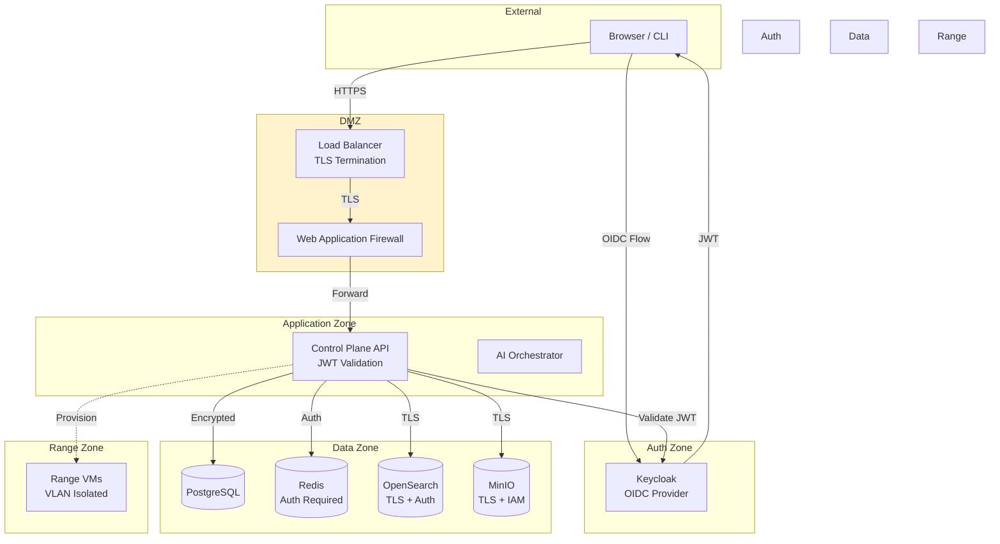
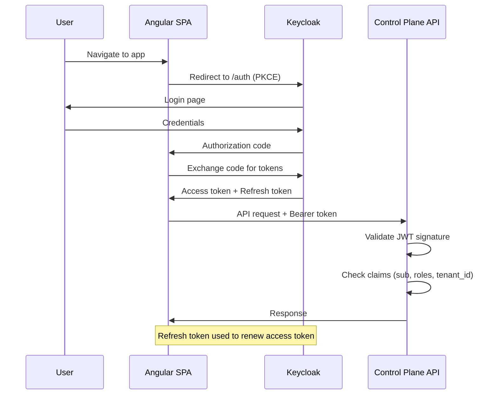
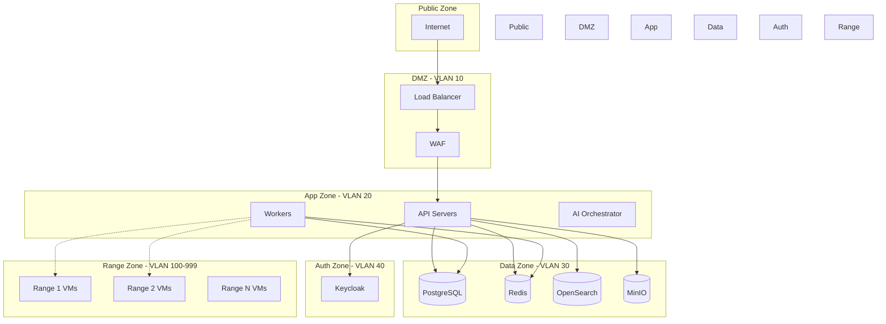

# TrueNorth Range — Security Guide

> Authentication, authorization, network security, encryption, audit logging, vulnerability management, and compliance mapping for TrueNorth Range deployments.

---

## Table of Contents

- [Security Architecture Overview](#security-architecture-overview)
- [Authentication: Keycloak OIDC](#authentication-keycloak-oidc)
- [Authorization: RBAC Model](#authorization-rbac-model)
- [Permissions Matrix](#permissions-matrix)
- [Network Security](#network-security)
- [Encryption](#encryption)
- [Rate Limiting and Input Validation](#rate-limiting-and-input-validation)
- [Golden-image build pinning (ADR 0013 §2)](#golden-image-build-pinning-adr-0013-2)
- [Audit Logging](#audit-logging)
- [Vulnerability Management](#vulnerability-management)
- [Security Hardening Checklist](#security-hardening-checklist)
- [Compliance Mapping](#compliance-mapping)

---

## Security Architecture Overview



### Security Principles

1. **Defense in Depth** — Multiple security layers from network to application
2. **Least Privilege** — Each component and user gets minimum required permissions
3. **Zero Trust** — Every request is authenticated and authorized, no implicit trust
4. **Encryption** — TLS at the edge and to OpenSearch; stored credentials sealed by the
   application. Not everywhere: see [Encryption](#encryption) for the gaps
5. **Audit** — State changes in most sections write an audit row; see
   [Audit Logging](#audit-logging) for what is and is not covered
6. **Tenant Isolation** — Strict data separation between tenants

---

## Authentication: Keycloak OIDC

### Architecture

TrueNorth Range uses Keycloak 24 as the OpenID Connect (OIDC) identity provider. All authentication flows go through Keycloak — the API never handles passwords directly.



### JWT Token Structure

```json
{
  "iss": "https://auth.truenorth.local/realms/truenorth",
  "sub": "a1b2c3d4-e5f6-7890-abcd-ef1234567890",
  "aud": "truenorth-api",
  "exp": 1705312800,
  "iat": 1705309200,
  "realm_access": {
    "roles": ["instructor"]
  },
  "resource_access": {
    "truenorth-api": {
      "roles": ["instructor"]
    }
  },
  "tenant_id": "550e8400-e29b-41d4-a716-446655440000",
  "preferred_username": "john.doe",
  "email": "john.doe@example.com",
  "name": "John Doe"
}
```

### Keycloak Realm Configuration

Excerpt of `infra/keycloak/realm-truenorth.json` (the maintained source; the installer's
`60-keycloak` enforces the token, session, password and client settings on every run,
and `tests/contracts/test_keycloak_hardening.py` keeps the two equal):

```json
{
  "realm": "truenorth",
  "enabled": true,
  "sslRequired": "external",
  "bruteForceProtected": true,
  "permanentLockout": false,
  "failureFactor": 5,
  "maxFailureWaitSeconds": 300,
  "minimumQuickLoginWaitSeconds": 60,
  "waitIncrementSeconds": 60,
  "maxDeltaTimeSeconds": 3600,
  "passwordPolicy": "length(12) and notUsername(undefined) and passwordHistory(5)",
  "accessTokenLifespan": 300,
  "ssoSessionIdleTimeout": 3600,
  "ssoSessionMaxLifespan": 36000,
  "offlineSessionIdleTimeout": 604800,
  "clients": [
    {
      "clientId": "truenorth-web",
      "publicClient": true,
      "standardFlowEnabled": true,
      "directAccessGrantsEnabled": false,
      "attributes": { "pkce.code.challenge.method": "S256" }
    },
    {
      "clientId": "truenorth-api",
      "publicClient": false,
      "standardFlowEnabled": false,
      "directAccessGrantsEnabled": false,
      "serviceAccountsEnabled": true
    },
    {
      "clientId": "truenorth-cli",
      "publicClient": true,
      "standardFlowEnabled": false,
      "directAccessGrantsEnabled": false,
      "attributes": {
        "oauth2.device.authorization.grant.enabled": "true",
        "pkce.code.challenge.method": "S256"
      }
    },
    {
      "clientId": "truenorth-smoke",
      "enabled": false,
      "publicClient": false,
      "directAccessGrantsEnabled": true
    }
  ]
}
```

**Multi-factor sign-in (v1.2.0).** admin, instructor (including `TN-Content-Authors`),
range_ops and observer sign in with a password and an authenticator-app code (TOTP);
Students with a password, LTI-launched Students through Moodle. The installer builds the
`tn-browser` flow and the `tn-mfa-required` role on the privileged groups
(`scripts/keycloak_mfa.py`); the API refuses a privileged **database** role whose token
shows no second factor, on every request and WebSocket (`control-plane/api/app/mfa_policy.py`).
Details, enrolment and break-glass: `docs/identity.md` ("MFA"), `docs/runbooks/break-glass.md`.

**Risk acceptance: the master realm administrator.** Keycloak's master realm admin
(`KEYCLOAK_ADMIN`, escrowed by `backup.sh`) signs in with a password only. It is published
on the host's loopback port only and nginx answers 404 for `/auth/admin` and
`/auth/realms/master`, so using it needs an SSH login to the host. It is the installer's
and the break-glass playbook's credential. Applying `tn-browser` to the master realm would
add a lockout with no recovery path short of the database; not done in v1.2.0.

`truenorth-smoke` exists only for the installer's smoke test, which enables it for one
token request and disables it again (`install/roles/tn_smoke`). Sign-in flows:
`docs/api.md` ("Authentication").

**Login banner (v1.2.0).** The `truenorth` login theme shows the site's system-use
notice above the sign-in form on each interactive sign-in, with an acknowledgement box the
browser requires (`infra/keycloak/themes/truenorth`, text from `tn_login_banner_text`;
AC-8 below).

### API JWT Validation

The Control Plane API validates every incoming JWT:

1. **Signature verification** — RS256 using Keycloak's JWKS endpoint
2. **Issuer check** — Must match configured Keycloak realm URL
3. **Audience check** — Must include `truenorth-api`
4. **Expiration check** — Token must not be expired
5. **Role extraction** — Roles mapped from `realm_access.roles`
6. **Tenant extraction** — `tenant_id` claim for multi-tenant isolation

```python
# Simplified JWT validation flow (see control-plane/api/app/rbac.py)
async def get_current_user(token: str = Depends(oauth2_scheme)):
    payload = jwt.decode(
        token,
        key=jwks_client.get_signing_key(token).key,
        algorithms=["RS256"],
        audience="truenorth-api",
        issuer=settings.KEYCLOAK_ISSUER,
    )
    user = await get_user_by_sub(payload["sub"])
    if not user:
        raise HTTPException(401, "User not found")
    return user
```

---

## Authorization: RBAC Model

TrueNorth Range implements fine-grained Role-Based Access Control defined in `control-plane/api/app/rbac.py`.

### Roles

| Role | Description | Typical User |
|------|-------------|-------------|
| `admin` | Full platform administration | Platform administrators |
| `instructor` | Create/manage ranges, exercises, scenarios | Training instructors |
| `student` | Participate in exercises, view own data | Trainees |
| `observer` | Read-only access to ranges and exercises | Evaluators, auditors |
| `range_ops` | Infrastructure operations, provisioning | DevOps / range operators |

### Permission Categories

Permissions follow the pattern `resource:action`:

| Category | Permissions |
|----------|------------|
| **Range** | `range:create`, `range:read`, `range:update`, `range:delete`, `range:provision`, `range:destroy`, `range:batch_provision`, `range:lease_force_release`, `range:credentials_read` |
| **Template** | `template:create`, `template:read`, `template:update`, `template:delete` |
| **Scenario** | `scenario:create`, `scenario:read`, `scenario:update`, `scenario:delete` |
| **Exercise** | `exercise:create`, `exercise:read`, `exercise:update`, `exercise:delete`, `exercise:control` |
| **User** | `user:create`, `user:read`, `user:update`, `user:delete` |
| **Tenant** | `tenant:create`, `tenant:read`, `tenant:update`, `tenant:delete` |
| **Audit** | `audit:read` |
| **Telemetry** | `telemetry:read` |
| **Stats** | `stats:read` |
| **AAR** | `aar:generate`, `aar:read` |
| **Schedule** | `schedule:read`, `schedule:write`, `schedule:admin` (ADR 0004: Students hold none) |

---

## Permissions Matrix

Complete role-to-permission mapping as defined in `rbac.py`:

| Permission | admin | instructor | student | observer | range_ops |
|------------|:-----:|:----------:|:-------:|:--------:|:---------:|
| `range:create` | X | X | | | X |
| `range:read` | X | X | X | X | X |
| `range:update` | X | X | | | X |
| `range:delete` | X | X | | | X |
| `range:provision` | X | X | | | X |
| `range:destroy` | X | X | | | X |
| `range:batch_provision` | X | | | | X |
| `range:lease_force_release` | X | | | | |
| `range:credentials_read` (ADR 0012; Students read only accounts handed to them on ranges they take part in, without it) | X | X | | | X |
| `template:create` | X | X | | | |
| `template:read` | X | X | X | X | X |
| `template:update` | X | X | | | |
| `template:delete` | X | X | | | |
| `scenario:create` | X | X | | | |
| `scenario:read` | X | X | X | X | |
| `scenario:update` | X | X | | | |
| `scenario:delete` | X | X | | | |
| `exercise:create` | X | X | | | |
| `exercise:read` | X | X | X | X | |
| `exercise:update` | X | X | | | |
| `exercise:delete` | X | X | | | |
| `exercise:control` | X | X | | | |
| `user:create` | X | | | | |
| `user:read` | X | X | | | |
| `user:update` | X | | | | |
| `user:delete` | X | | | | |
| `enrollment:manage_own` (#200: enrol/withdraw Students on a course you teach) | X | X | | | |
| `team:manage_own` (#200: create/edit teams of an exercise you run; Students only) | X | X | | | |
| `tenant:create` | X | | | | |
| `tenant:read` | X | | | | |
| `tenant:update` | X | | | | |
| `tenant:delete` | X | | | | |
| `audit:read` | X | | | | |
| `telemetry:read` | X | X | X | X | |
| `stats:read` | X | X | | X | X |
| `aar:generate` | X | X | | | |
| `aar:read` | X | X | X | X | |
| `schedule:read` | X | X | | X | X |
| `schedule:write` | X | X | | | |
| `schedule:admin` | X (platform tenant only when `PLATFORM_TENANT_ID` is set) | | | | |

**An instructor's own class (#200).** `enrollment:manage_own` and `team:manage_own` are
scoped in `app/class_setup/scope.py` (rule (a)). An instructor *teaches* a course, or
*runs* an exercise, only while their **own** booking of it is upcoming or running: it names
them its `instructor_id`, it has not ended, and it is not `draft`, `cancelled` or
`completed`. A past or completed booking grants nothing. While **another** booking of the
same course or exercise is running (not theirs, including one with no instructor), every
change is refused with 409. A booking of an exercise is one naming the exercise or its range
(as `exercise_participants` links them). The run itself also counts: while the exercise is
`running` or `paused` and no running booking of it is the caller's (started by hand, or
overrunning its booking), its teams are 409; while any exercise rostered through a course
(`roster_courses`) is running or paused and not under the caller's own running booking,
that course's enrolments are 409. Courses and exercises have no owner column; the calendar
is the only record of who teaches what. Bookings stay self-service (`schedule:write`), but
only an administrator (`schedule:admin`) moves a booking from one instructor to another: an
instructor hands on their own booking, or takes one with no instructor for themselves before
it starts, and the audit row records the instructor before and after. Editing, scheduling,
activating, completing or cancelling another instructor's booking is theirs or an
administrator's to do (403 otherwise), so a colleague's live class cannot be ended to free it.
Booking an exercise that is `running`, `paused`, `completed` or `cancelled` needs
`schedule:admin`, and a running exercise counts as the caller's only under their running
booking made before `started_at`: a booking made after a run began joins it, it does not run it.

Within scope an instructor enrols and withdraws Students, and creates, edits and deletes the
exercise's teams. Team members must be Students with an active enrolment of `source =
"assigned"` (staff enrolments, approvals, imports, LTI/Moodle sync and lab launches; never a
self-enrolment) in the course of the instructor's own session of that exercise, because team
membership opens the exercise's after-action report (`aar_access.took_part`, ADR 0005 §5).
A `completed` or `cancelled` exercise's teams are frozen for everyone, admins included: no
team created, edited or deleted, no member added or removed (409). An instructor cannot
delete a team with staff on it, withdraw a `completed` or `failed` enrolment (409), or
reset an outcome by re-enrolling: only a withdrawn enrolment with no completion and no
grade reopens, to `in_progress` if it had started. Reopening, like turning a self-enrolment
into an assigned one, moves `enrollments.enrolled_at` to now: it is the start of the
current seat ("rostered since"), and the AAR roster counts an enrolment for a run only if
the later of `created_at` and `enrolled_at` is no later than the run's end, so re-enrolling
never seats a Student in a run held while they were withdrawn. **Known limitation:** only
the current seat is recorded, so a Student who sat a run on the roster, was withdrawn and is
re-enrolled afterwards also loses that run's AAR, unless a team or a detection they
submitted ties them to it; the fix is a history of seat periods (follow-up). A team's `ou_id` must
be an OU of the caller's tenant and `nation_id` a known nation (422). Another course or
exercise, a standing team (no exercise) and any staff target are 403; another tenant's
course, exercise, team or person is 404. Every change is audited (`enrollment_create`,
`enrollment_update`, `enrollment_withdraw`; team `create`, `update`, `delete` with the
members removed, `add_member`, `remove_member`). `user:update` (admins) is unchanged apart
from the finished-exercise and team-reference checks.

**Platform-shared curriculum.** The QSP qualification spine (`/qsp/import-crosswalk`,
`/qsp/import-competency-crosswalk`) and the competency catalogue (`POST
/competency/frameworks`, `/competency/frameworks/import-nice`) are shared by every tenant.
Writing them needs `course:author` + `tenant:read` (`PLATFORM_CURRICULUM_WRITE`), so only a
platform admin may; an instructor (tenant-level author) is refused with 403.

### Permission Enforcement

Permissions are enforced at the API endpoint level using FastAPI dependency injection:

```python
# Single permission required
@router.post("/ranges", dependencies=[Depends(require_permission(Permission.RANGE_CREATE))])
async def create_range(...):
    ...

# Any of multiple permissions
@router.get("/stats", dependencies=[Depends(require_any_permission(
    Permission.STATS_READ, Permission.RANGE_READ
))])
async def get_stats(...):
    ...

# Tenant-scoped access
@router.get("/ranges/{range_id}")
async def get_range(
    range_id: UUID,
    tenant_check=Depends(require_tenant_access),
    perm_check=Depends(require_permission(Permission.RANGE_READ)),
):
    ...

# Range-specific access
@router.post("/ranges/{range_id}/provision")
async def provision_range(
    range_id: UUID,
    access=Depends(require_range_access),
    perm=Depends(require_permission(Permission.RANGE_PROVISION)),
):
    ...
```

---

## Network Security

### Network Architecture



### VLAN Isolation

| VLAN | Name | Purpose |
|------|------|---------|
| 10 | DMZ | Load balancers, WAF |
| 20 | Application | API servers, workers, AI |
| 30 | Data | PostgreSQL, Redis, OpenSearch, MinIO |
| 40 | Authentication | Keycloak |
| 100-999 | Range VLANs | Individual range environments (isolated per range) |

### Firewall Rules

```
# DMZ -> Application
ALLOW VLAN10 -> VLAN20:8080 (HTTPS to API)
ALLOW VLAN10 -> VLAN20:443  (WebSocket)

# Application -> Data
ALLOW VLAN20 -> VLAN30:5432 (PostgreSQL)
ALLOW VLAN20 -> VLAN30:6379 (Redis)
ALLOW VLAN20 -> VLAN30:9200 (OpenSearch)
ALLOW VLAN20 -> VLAN30:9000 (MinIO)

# Application -> Auth
ALLOW VLAN20 -> VLAN40:8443 (Keycloak)

# Application -> Range (provisioning only)
ALLOW VLAN20 -> VLAN100-999:22   (SSH for provisioning)
ALLOW VLAN20 -> VLAN100-999:5985 (WinRM)

# Range Isolation
DENY  VLAN100 -> VLAN200  (Range-to-range blocked)
DENY  VLAN100 -> VLAN30   (Range-to-data blocked)
ALLOW VLAN100 -> VLAN20:9200 (Telemetry to OpenSearch only)

# Default
DENY ALL
```

### Range VLAN Isolation

Each provisioned range receives a dedicated VLAN (100-999):

- **No cross-range traffic** — Ranges cannot communicate with each other
- **No data zone access** — Ranges cannot directly access PostgreSQL, Redis, etc.
- **Telemetry egress only** — Range VMs can send telemetry to OpenSearch
- **Management ingress only** — Only provisioning workers can reach range VMs

---

## Encryption

### Encryption in Transit

As shipped in `infra/platform/docker/compose.prod.yml` (checked 2026-10-12):

| Connection | Protected | Evidence |
|-----------|----------|----------------|
| Browser → nginx edge | TLS 1.2/1.3, HSTS | `infra/platform/nginx/conf.d/ssl-params.conf`, `snippets/security-headers-common.conf` |
| nginx → API, web, Keycloak | No (plain HTTP on the compose network) | `conf.d/truenorth.conf` |
| API/worker → PostgreSQL (pgbouncer) | No | `DATABASE_URL` with no `sslmode` |
| API/worker → Redis | Password, no TLS | `REDIS_URL=redis://` |
| API → MinIO | No | `MINIO_ENDPOINT=http://minio:9000` |
| API → Keycloak (JWKS) | No | `KEYCLOAK_URL=http://keycloak:8080/auth` |
| API/worker → OpenSearch | TLS, installer's internal CA | security plugin `ssl.http.enabled=true` |
| Kubernetes inter-pod | No service mesh; nothing configures mTLS | `infra/k8s/helm/` |

Internal traffic relies on the host's container network not being reachable from outside.

### TLS Configuration

```nginx
# Recommended TLS settings (nginx; the shipped ssl-params.conf sets the protocols)
ssl_protocols TLSv1.2 TLSv1.3;
ssl_ciphers ECDHE-ECDSA-AES128-GCM-SHA256:ECDHE-RSA-AES128-GCM-SHA256:ECDHE-ECDSA-AES256-GCM-SHA384:ECDHE-RSA-AES256-GCM-SHA384;
ssl_prefer_server_ciphers on;
ssl_session_timeout 1d;
ssl_session_cache shared:SSL:50m;
ssl_stapling on;
ssl_stapling_verify on;

# HSTS
add_header Strict-Transport-Security "max-age=63072000; includeSubDomains; preload" always;
```

### Encryption at Rest

TrueNorth ships no Vault, no KMS integration, no database TDE and no disk encryption
(LUKS). The one application-level encryption at rest is the sealed-credential columns
below; anything more is the host's job (for example an encrypted volume under
`/var/lib/docker`), and the installer does not set it up.

| Data Store | Encrypted at rest by TrueNorth? | Notes |
|-----------|--------|---------------|
| PostgreSQL | No | Plain data files. Credential columns are sealed (last row) |
| OpenSearch | No | The security plugin provides TLS and auth, not at-rest encryption |
| MinIO | No | No SSE or KMS configured |
| Redis | No | Broker and cache only, not backed up |
| Backups | Partly | Database dumps and MinIO mirrors are plain; the env file and secrets directory are AES-256 encrypted to the escrow RSA public key (`scripts/backup/backup.sh`) |
| Stored credentials (hypervisor passwords and API tokens, AI engine keys) | Yes: Fernet (AES-128-CBC + HMAC-SHA256), sealed by the application | `TN_SECRETS_KEY`, an environment value; no external key manager |

#### Stored credentials

Hypervisor connection passwords and API tokens (`hypervisor_connections.password_encrypted`,
`.api_token`) and AI engine keys (`ai_backend_configs.api_key_encrypted`) are sealed before
they are written and unsealed only where a login needs them (`app/secretbox.py`; the
worker has a byte-identical copy, `worker/secretbox.py`). The API never returns them.

- **Key.** `TN_SECRETS_KEY`: at least 32 random characters (`openssl rand -hex 32`), the
  same value for the api and every worker. The installer generates it once and never
  again (`vault_secrets_key`); Helm takes `secrets.secretsKey`. The dev compose file uses
  a public dev-only value.
- **Without a key** nothing is stored: saving a credential, testing a connection or calling
  an AI engine that has one returns 503 naming the setting. Production compose refuses to
  start without it. A connection or engine with no credential needs no key.
- **Back the key up with the database.** A credential sealed with a lost key cannot be
  read (503); the fix is to re-enter it.
- **Rotation.** Set `TN_SECRETS_KEY=new,old` and restart api and workers: new values are
  sealed with `new`, old ones still open. Re-save each credential, then drop `old`.
- **Upgrade.** Migration `f4b5c6d7e8a9` seals existing plaintext values and refuses to run
  without the key if there are any. Its downgrade unseals them for a rollback.
- **Not covered:** `external_platforms.credentials_encrypted` (LMS integrations). No code
  writes it today; whatever starts to must seal it with the same module.

---

## Rate Limiting and Input Validation

### Rate Limiting

Two layers. The API keeps a per-user-per-address sliding window in Redis
(`control-plane/api/app/middleware.py`; on unless `RATE_LIMIT_ENABLED` is not `true`),
answering 429 with `Retry-After`:

| Requests | Limit per minute |
|----------|------------------|
| Default (`RATE_LIMIT_DEFAULT`) | 100 |
| Any `GET` | 200 |
| `POST /ranges` | 30 |
| `POST /ranges/batch-provision` | 5 |
| `POST /ai/…` | 20 |
| Exercise Forge, quiz generation, AAR AI enhance, MESL generation | 10 each |
| Curriculum AI search and course generation, detection submissions | 30 each |

All users behind one address together get at most 10 times the per-user limit. The nginx
edge adds per-address `limit_req` zones and 100 connections per address
(`infra/platform/nginx/nginx.conf`). Keycloak's brute-force detection covers sign-in.

### Input Validation

API request bodies are Pydantic v2 models (`control-plane/api/app/schemas.py` and the
section modules), in the default (lax) mode. For example:

```python
class RangeIn(BaseModel):
    name: str = Field(..., min_length=1, max_length=255)
    template_id: uuid.UUID
```

**Validation rules applied:**
- **String lengths and numeric bounds** — where a model declares them; not on every field
- **UUID format** — path and body IDs typed as UUIDs
- **Enum values** — State/type fields restricted to valid enum values
- **No SQL injection** — SQLAlchemy parameterized queries throughout
- **No XSS** — Output encoding in templates; Angular auto-escapes
- **YAML validation** — Scenario YAML parsed with safe_load, schema-validated

---

## Golden-image build pinning (ADR 0013 §2)

Ranges clone only an image's **promoted build**: the copy its build record names for the
placed host, which must carry the stamp `tn-build: <catalogue id> <build id> sha256:<checksum>`
in its vCenter annotation. Recording a build (`PATCH /golden-images/{id}` with `build`) and
promoting one (`POST /golden-images/{id}/builds/{build_id}/promote`) are **platform
administrator** only (`rbac.require_platform_admin`): one record serves every tenant. Each
promotion is in the audit log.

What this does and does not prove:

- The **checksum** is the sha256 of the build's identity: build id, template, the ISO
  checksum the operator supplies (`TN_ISO_CHECKSUM`) and the hash of every Packer input
  file. It fingerprints what the build was made from; it is **not** a hash of the
  template's disks.
- The **stamp** guards against **mix-ups**: a copy of another build, another image, a
  rebuild left under the same name, a copy moved to another host. It does **not** guard
  against **tampering**: anyone with vCenter rights to edit a template's annotation or
  disks can make a modified template carry a valid stamp. Protecting the templates is
  vCenter's access control (who may edit `TrueNorth/Templates`), not TrueNorth's.
- `TN_TEMPLATE_ALLOW_UNPROMOTED` (transition only) lets `built` images without a
  promoted build through, unverified, with a warning on the range.

## Audit Logging

### What Is Audited

Routers and services write `AuditLog` rows for their state changes: ranges (create, update,
delete, provision, power, destroy, abandon, snapshots), exercises (create, start, pause,
resume, complete, objective acknowledgement), detections, templates, scenarios and
executions, users, roster imports, teams, tenants, registrations, the scheduler, noise,
Greyspace, threat intel, detection rules, wiki and tickets. Coverage is per call site, not
enforced centrally, so a new endpoint is audited only if it writes a row.

**Not in `audit_logs`:** sign-in success or failure, sign-out and authenticator changes are
Keycloak login events (the event store and admin events are enabled by 60-keycloak and
kept 90 days); reads are not logged.

### Audit Log Schema

`AuditLog` in `control-plane/api/app/models.py`:

| Column | Type | Notes |
|--------|------|-------|
| `id` | UUID | |
| `timestamp` | timestamptz | set by the database clock at insert (`tn_audit_insert_stamp`), whatever the writer sent |
| `user_id` | UUID, nullable | who acted |
| `tenant_id` | UUID, nullable | legacy rows may have none |
| `action` | varchar(100) | e.g. `create`, `provision`, `ack_objective` |
| `resource_type` | varchar(100) | e.g. `range`, `exercise` |
| `resource_id` | varchar(255) | |
| `detail` | text, nullable | free text |

Indexes: `(tenant_id, timestamp)` and `(resource_type, resource_id)`. The record has no
source IP address and no user agent.

### Querying Audit Logs

The only reader is a paged list, newest first: `GET /audit-log?limit=…&offset=…`
(`audit:read`; `limit` at most 500). Only the admin role holds `audit:read`. It is scoped
to the caller's tenant; legacy rows with no tenant are not shown. Only the platform
administrator (an admin of `PLATFORM_TENANT_ID`'s tenant, or of a single-tenant install;
`rbac.is_platform_admin`) sees every tenant's entries and the legacy rows, and may narrow
them with `tenant_id`; anyone else asking for another tenant gets 403. (Before v1.2.0 any
holder of `tenant:read`, so every tenant's admin, read every tenant's log.) The web app
shows it under **Admin → Audit Log**. There is no filtering by date, user or resource.

For anything else, query the database directly:

```sql
SELECT timestamp, user_id, action, resource_type, resource_id, detail
FROM audit_logs
WHERE tenant_id = '<tenant-id>'
  AND timestamp >= '2026-01-01' AND timestamp < '2026-02-01'
ORDER BY timestamp DESC;
```

### Audit Log Integrity (ADR 0011)

- **Append-only in PostgreSQL** (migration `b7c8d9e0f1a2`). A trigger refuses every
  `UPDATE` of `audit_logs` and every `TRUNCATE` of `audit_logs`, `audit_exports` and
  `audit_export_checks`; inserts are stamped with the database clock, so nothing can be
  backdated into a day already exported.
- **One delete path.** A row is deleted only in a transaction that set `tn.audit_purge`,
  only when it is at least 30 days old (a floor in the trigger), and only when its day has
  an export and a re-verification check of it (same manifest hash) less than a day old.
  The retention job writes that check only after the files verify against a key the
  database recorded and the recorded manifest hash, and hold exactly the table's rows; it
  writes an `audit.purge` row for each day it deletes.
- **Signed daily export.** The worker writes each finished UTC day to
  `AUDIT_ARCHIVE_PATH` (`/srv/truenorth/audit-archive` on an installed host): a gzipped
  JSON-lines file, a manifest (the file's SHA-256, the previous manifest's SHA-256: one hash
  chain) and an Ed25519 signature over the manifest. The key derives from the installer
  secret `audit_signing_seed`; its fingerprint is printed at the end of the install to be
  recorded out of band. Verify a day with OpenSSL 3:

  ```bash
  cd /srv/truenorth/audit-archive
  openssl pkeyutl -verify -pubin -inkey keys/<key_id>.pub.pem -rawin \
    -in 2026/10/audit-2026-10-11.manifest.json -sigfile 2026/10/audit-2026-10-11.manifest.json.sig
  ```

  and everything with `python -m worker.audit_verify --db` in the worker image. Every
  backup copies the archive and verifies signatures, hashes, the chain and `audit_exports`
  (exit 6 and the critical `AuditArchiveTampered` alert when they disagree; the backup is
  still copied off-host). A restore moves archive days newer than the restored database to
  `quarantine/` (kept). The restore drill covers both.
- **What this does not do.** The application connects as the database **owner**, which
  can disable the triggers or write export and check rows itself, and the signing seed is
  on the same host. Against a compromised application or host this is **detection, not
  prevention**: the chain, the out-of-band fingerprint and off-host verified backups show
  it. A non-owner role (without UPDATE/DELETE/TRUNCATE on `audit_logs` and without INSERT
  on `audit_exports`/`audit_export_checks`) and WORM storage are v1.3.

### Audit Log Retention

- **In the database:** 90 days (`tn_audit_hot_retention_days`, never below 30; 0 keeps
  rows forever), deleted day by day only after the day's export verifies.
- **Archive:** kept until the operator prunes it; TrueNorth never deletes archive files.
  Every backup holds a verified copy.
- No 365-day or 7-year tiers exist; an operator who needs them keeps the archive and the
  backups that long.

---

## Vulnerability Management

What CI actually runs (`.github/workflows/ci.yml`, `release.yml`): pip-audit and npm audit
on every run (blocking); Trivy, checksum-pinned, on each built image (fixable CRITICAL
blocks a PR; a release blocks on fixable HIGH and CRITICAL). The commands below are for
scanning by hand.

### Container Scanning

```bash
# Scan container images with Trivy
trivy image truenorth/control-plane-api:latest
trivy image truenorth/celery-worker:latest
trivy image truenorth/ai-orchestrator:latest
trivy image truenorth/scenario-engine:latest

# Scan in CI/CD pipeline (fail on HIGH/CRITICAL)
trivy image --exit-code 1 --severity HIGH,CRITICAL truenorth/control-plane-api:latest
```

### Dependency Scanning

```bash
# Python dependencies
pip-audit --requirement requirements.txt

# Node.js dependencies (frontend)
npm audit --production

# Go dependencies (if applicable)
govulncheck ./...
```

### Patch Management

A recommended cadence for operators; TrueNorth does not schedule or enforce it.

| Component | Update Frequency | Method |
|-----------|-----------------|--------|
| OS packages (containers) | Weekly | Rebuild base images |
| Python packages | Monthly (critical: immediate) | pip-compile + CI |
| Node.js packages | Monthly (critical: immediate) | npm update + CI |
| Keycloak | Quarterly | Helm upgrade |
| PostgreSQL | Quarterly | Rolling restart |
| OpenSearch | Quarterly | Rolling restart |

### Penetration Testing

No penetration test has been performed on TrueNorth. A recommended programme for an
operator: an external test before production and annually, covering the whole platform
including range VMs, with authentication bypass, privilege escalation, tenant isolation
and injection as focus areas.

---

## Security Hardening Checklist

### API Server

- [ ] TLS 1.2+ enforced on all endpoints
- [ ] CORS configured with specific allowed origins (not `*`)
- [ ] Security headers set (HSTS, X-Content-Type-Options, X-Frame-Options, CSP)
- [ ] Rate limiting enabled on all endpoints
- [ ] Request size limits enforced (default: 10 MB)
- [ ] JWT validation with signature verification
- [ ] All inputs validated via Pydantic models
- [ ] SQLAlchemy parameterized queries (no string formatting)
- [ ] Error messages do not leak internal details
- [ ] Debug mode disabled in production
- [ ] Health endpoints do not expose sensitive info

### Database

- [ ] Strong passwords (32+ chars, generated)
- [ ] TLS required for all connections
- [ ] Connection limited to application subnet only
- [ ] Regular VACUUM and REINDEX
- [ ] Backup encryption enabled
- [ ] pg_stat_statements enabled for query auditing
- [ ] Row-level security considered for multi-tenant tables

### Redis

- [ ] Authentication required (`requirepass`)
- [ ] TLS enabled
- [ ] Bind to internal interface only
- [ ] `CONFIG` command renamed/disabled
- [ ] Memory limit set with eviction policy
- [ ] No persistent storage of secrets

### OpenSearch

- [ ] Security plugin enabled
- [ ] TLS for transport and REST layers
- [ ] Role-based access for indices
- [ ] Audit logging enabled
- [ ] Index-per-range for tenant isolation

### MinIO

- [ ] TLS enabled
- [ ] IAM policies per tenant
- [ ] Bucket versioning enabled
- [ ] Server-side encryption enabled
- [ ] Access logging enabled

### Keycloak

- [ ] Admin console restricted to internal network
- [ ] Brute force protection enabled
- [ ] Password policy configured (see above)
- [ ] Session timeouts configured
- [ ] PKCE required for SPA client
- [ ] Token lifetimes minimized (1 hour access, 24 hour refresh)
- [ ] Unused realms and clients removed

### Infrastructure

- [ ] All nodes updated with latest security patches
- [ ] SSH key-based auth only (no password)
- [ ] Kubernetes RBAC configured (least privilege)
- [ ] Network policies enforced
- [ ] Pod security standards enforced
- [ ] Secrets stored in Vault or K8s secrets (encrypted)
- [ ] Container images from trusted registries only
- [ ] No containers running as root

---

## Compliance Mapping

Checked against `github/main` on 2026-10-12 (v1.2.0). This is a self-assessment of what the
code and shipped configuration do, not an accreditation, and it is not evidence that any
control has been assessed. **Implemented** means the code or shipped configuration does it;
**Partial** says exactly what is missing; **Not implemented** means nothing in the
repository does it, whatever an operator could add.

### NIST 800-53 Controls

| Control | Status | What exists, and the gap | Evidence |
|---------|--------|--------------------------|----------|
| AC-2 Account Management | Partial | Accounts are created only by approving an access request (instructor or admin); admins manage users. No automated disabling of inactive accounts; deprovisioning relies on the directory | `control-plane/api/app/routers/registration.py`, `control-plane/api/app/routers/admin.py`, `docs/onboarding.md` |
| AC-3 Access Enforcement | Implemented | 60 permissions over 5 roles, checked per route; tenant ownership checked on lookups | `control-plane/api/app/rbac.py`, `control-plane/api/app/tenancy.py` |
| AC-6 Least Privilege | Partial | Five roles with distinct permission sets. The admin role holds every permission, including cross-tenant reads | `control-plane/api/app/rbac.py` (`ROLE_PERMISSIONS`) |
| AC-7 Unsuccessful Logon Attempts | Implemented (Keycloak) | Brute-force detection after 5 failures, temporary lockout growing by 60 s up to 300 s; no permanent lockout. AD-federated accounts are also subject to the directory's own policy | `infra/keycloak/realm-truenorth.json`, `tests/contracts/test_keycloak_hardening.py` |
| AC-8 System Use Notification | Partial | The Keycloak `truenorth` login theme shows the site's notice (`tn_login_banner_text`, set per site as realm localization) above the sign-in form on each interactive sign-in (each SSO session, at most 10 h), on the loopback-only master console too. Gaps: the acknowledgement box is enforced by the browser only (HTML `required`); Keycloak 24 has no per-sign-in server-side acknowledgement (Terms and Conditions records one acceptance per user; anything else needs a Java SPI authenticator). LTI-launched Students sign in through Moodle, which shows no banner (owner decision) | `infra/keycloak/themes/truenorth/login/login.ftl`, `install/roles/tn_keycloak/tasks/banner.yml`, `scripts/check_keycloak_realm.sh` |
| AC-12 Session Termination | Implemented (Keycloak) | Access token 5 min, SSO idle 60 min, SSO maximum 10 h, offline session 7 days | `install/roles/tn_keycloak/defaults/main.yml` (`tn_kc_realm_settings`) |
| AU-2 Event Logging | Partial | State changes in most sections write an audit row. Sign-ins, failures, sign-outs and authenticator changes are Keycloak login events (event store and admin events enabled by 60-keycloak, kept 90 days), not TrueNorth audit rows; reads are not logged | `control-plane/api/app/models.py` (`AuditLog`), `install/roles/tn_keycloak/files/mfa-spec.json`; [Audit Logging](#audit-logging) |
| AU-3 Content of Audit Records | Partial | Time, user, tenant, action, resource type and id, free-text detail. No source IP, user agent or outcome (success or failure) | `control-plane/api/app/models.py` (`AuditLog`) |
| AU-6 Audit Review | Partial | A paged, newest-first list (`GET /audit-log`, Admin → Audit Log), scoped per tenant; only the platform administrator (`PLATFORM_TENANT_ID`) reads across tenants, with a `tenant_id` filter. No search, date or user filter, correlation, reporting or alerting on audit events | `control-plane/api/app/routers/admin.py` (`list_audit_log`), `tests/api/test_audit_scope.py` |
| AU-9 Protection of Audit Information | Partial | The database refuses UPDATE and TRUNCATE of `audit_logs`, stamps inserts with its own clock, and allows DELETE only through the retention path (`tn.audit_purge`, rows 30+ days old, an export and a fresh re-verification check of it). Signed (Ed25519) daily export with a hash chain, verified in every backup and the restore drill. Gap: the application connects as the database owner, which can disable triggers or write export rows, so against a compromised application or host this is detection (chain, out-of-band key fingerprint, off-host backups), not prevention; non-owner role and WORM storage are v1.3 | `control-plane/api/alembic/versions/b7c8d9e0f1a2_audit_log_append_only.py`, `control-plane/worker/worker/audit_jobs.py`, `docs/adr/0011-audit-log-integrity.md`, `tests/api/test_audit_append_only_postgres.py` |
| AU-11 Audit Record Retention | Implemented | 90 days in the database (`tn_audit_hot_retention_days`, floor 30, 0 = forever), each day deleted only after its export verifies; the signed archive is kept until the operator prunes it, and every backup holds a verified copy. No 365-day or 7-year tiers: keep the archive and backups as long as the site's policy requires | `control-plane/worker/worker/audit_jobs.py`, `scripts/backup/backup.sh`, `docs/runbooks/backup-restore.md` |
| CA-7 Continuous Monitoring | Partial | Prometheus, Alertmanager and Grafana with unit-tested alert rules. Alert delivery through Alertmanager has not been exercised on staging | `infra/platform/docker/compose.monitoring.yml`, `tests/contracts/test_prometheus_rules.py` |
| CA-8 Penetration Testing | Not implemented | No penetration test has been performed or scheduled. Internal code security sweeps only | — |
| CM-2 Baseline Configuration | Partial | Configuration as code: the Ansible installer, `compose.prod.yml` by image digest, a Helm chart, Packer image builds. No drift detection. (Terraform was removed in #131.) | `install/`, `infra/platform/docker/compose.prod.yml`, `infra/k8s/helm/`, `infra/vsphere/packer/` |
| CM-6 Configuration Settings | Partial | The installer enforces Keycloak token, session, password and client settings on every run. The [hardening checklist](#security-hardening-checklist) is guidance for the operator, not enforced | `install/roles/tn_keycloak/` |
| IA-2 Identification and Authentication | Partial | Keycloak OIDC with PKCE; optional read-only AD federation. IA-2(1)/(2): a second factor (TOTP) is required for admin, instructor, range_ops and observer, enforced by the API on every request and WebSocket from the database role (`amr`/`acr`; `acr` "1" never counts), with Keycloak's `tn-browser` flow, forced enrolment, step-up and an audited break-glass reset; production refuses to start without it, or with a realm not configured for it. Students: password only. Gaps: no WebAuthn yet, no CAC/PIV or smart-card support, and the master-realm admin is password-only (loopback only; risk acceptance under Keycloak Realm Configuration) | `control-plane/api/app/mfa_policy.py`, `scripts/keycloak_mfa.py`, `scripts/check_keycloak_mfa.sh`, `docs/identity.md` ("MFA") |
| IA-5 Authenticator Management | Partial | Local Keycloak accounts: minimum 12 characters, not the username, last 5 not reused. AD-federated passwords are governed by AD | `install/roles/tn_keycloak/defaults/main.yml` (`passwordPolicy`) |
| IR-4 Incident Handling | Partial | Written runbooks for incidents and on-call. No exercised incident on record | `docs/runbooks/incident.md`, `docs/runbooks/on-call.md` |
| IR-5 Incident Monitoring | Partial | Alert rules and runbook procedures exist; delivery unproven (see CA-7). No incident tracking system | `docs/operations.md`, `docs/runbooks/incident.md` |
| SC-8 Transmission Confidentiality | Partial | TLS 1.2/1.3 at the nginx edge with HSTS, and TLS to OpenSearch. Internal traffic to PostgreSQL, Redis, MinIO and Keycloak is plain on the container network | [Encryption in Transit](#encryption-in-transit) |
| SC-12 Cryptographic Key Management | Partial | One application key, `TN_SECRETS_KEY`, held in the env file, with a documented rotation (`new,old`) and escrow in the backups. No Vault, KMS or HSM | `control-plane/api/app/secretbox.py`, `docs/runbooks/key-rotation.md` |
| SC-13 Cryptographic Protection | Partial | Fernet (AES-128-CBC + HMAC-SHA256) for stored credentials; AES-256 with RSA key wrapping for the backup escrow. No FIPS 140-validated modules | `control-plane/api/app/secretbox.py`, `scripts/backup/backup.sh` |
| SC-28 Protection of Information at Rest | Partial | Only hypervisor credentials and AI engine keys are encrypted (sealed columns). No database TDE, no disk encryption (LUKS), no MinIO SSE, no OpenSearch at-rest encryption | [Encryption at Rest](#encryption-at-rest) |
| SI-2 Flaw Remediation | Implemented | Every CI run: pip-audit and npm audit (blocking), Trivy on built images (fixable CRITICAL blocks). Release: Trivy blocks fixable HIGH and CRITICAL | `.github/workflows/ci.yml`, `.github/workflows/release.yml` |
| SI-4 System Monitoring | Partial | Platform health and resource metrics (Prometheus exporters, host probes). No intrusion detection on the platform itself | `infra/platform/docker/compose.monitoring.yml` |
| SI-10 Information Input Validation | Implemented | Pydantic v2 request models; scenario YAML parsed safely and validated; telemetry search limited to a closed query language | `control-plane/api/app/schemas.py`, `control-plane/api/app/safe_yaml.py`, `control-plane/api/app/search_backends/query.py` |

### FedRAMP Alignment

For the FedRAMP Moderate baseline. TrueNorth is not FedRAMP authorized and no assessment has
been made.

| Area | Requirement | Status |
|------|------------|--------|
| Authentication | MFA for privileged users | **Implemented.** TOTP for every privileged role, enforced by the API and the Keycloak flow (IA-2); WebAuthn planned |
| Encryption | FIPS 140-validated modules | **Not implemented.** Images use standard, non-FIPS crypto libraries |
| Audit | Continuous audit log export | **Partial.** Daily signed export to the archive volume and into every (off-host) backup, verified at each backup; not immutable (WORM) storage, planned for v1.3 (see AU-9) |
| Monitoring | Continuous monitoring program | **Partial.** Prometheus, Alertmanager and Grafana; delivery not exercised (see CA-7) |
| Vulnerability Management | Monthly scanning | **Implemented** for code and images on every CI run and release (see SI-2). Deployed hosts are not scanned |
| Incident Response | Documented IR plan | **Partial.** Runbooks exist; never exercised (see IR-4) |
| Data Residency | Data within authorized boundaries | **Deployment-dependent.** Self-hosted: data stays on the hosts it is installed on. AI prompts go to the operator-configured AI endpoint (`tn_ai_*` installer variables, rendered to `OPENAI_BASE_URL`, which `compose.prod.yml` requires). Keep that endpoint inside the authorized boundary |

### SOC 2 Type II Relevance

| Trust Service Criteria | What exists |
|----------------------|----------------|
| **Security** | RBAC, sealed credentials, edge TLS, audit rows for most state changes |
| **Availability** | Health checks, backups with a nightly CI restore drill. No multi-site or HA deployment |
| **Processing Integrity** | Input validation, state machines with transition guards |
| **Confidentiality** | Tenant scoping on lookups. Gaps: plain internal traffic, no at-rest encryption beyond credentials |
| **Privacy** | Minimal PII collection, data retention policies |